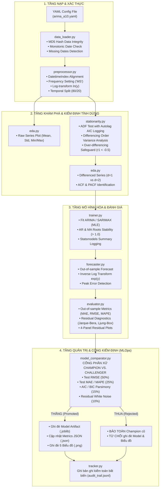

# GIẢI PHẪU CHI TIẾT KIẾN TRÚC PIPELINE & MÃ NGUỒN CỐT LÕI (CORE CODE)

**Dự án:** Phân tích Chuỗi thời gian (Time Series Analysis) — Lab 2  
**Mục tiêu:** Chuyển đổi toàn diện các quy trình thực nghiệm thống kê (EDA, ADF Test, Box-Jenkins, ARIMA/SARIMA, Chẩn đoán phần dư, Dự báo) sang kiến trúc **Production-Grade MLOps Pipeline**.

---

## MỤC LỤC
1. [TỔNG QUAN KIẾN TRÚC & SƠ ĐỒ LUỒNG DỮ LIỆU](#1-tổng-quan-kiến-trúc--sơ-đồ-luồng-dữ-liệu)
2. [BẢN CHẤT CÁC ĐỊNH DẠNG TỆP TRONG HỆ THỐNG (YAML, LOG, JSON, JSONL)](#2-bản-chất-các-định-dạng-tệp-trong-hệ-thống)
3. [GIẢI PHẪU CHI TIẾT TỪNG MODULE MÃ NGUỒN CỐT LÕI (SRC/)](#3-giải-phẫu-chi-tiết-từng-module-mã-nguồn-cốt-lõi)
4. [CƠ CHẾ CỔNG KIỂM ĐỊNH MÔ HÌNH (CHAMPION VS. CHALLENGER GATE)](#4-cơ-chế-cổng-kiểm-định-mô-hình-champion-vs-challenger-gate)
5. [QUY TRÌNH VẬN HÀNH, THỰC THI & KIỂM THỬ TỰ ĐỘNG](#5-quy-trình-vận-hành-thực-thi--kiểm-thử-tự-động)

---

# 1. TỔNG QUAN KIẾN TRÚC & SƠ ĐỒ LUỒNG DỮ LIỆU

Pipeline được thiết kế theo nguyên lý **Đóng gói hướng module (Modular Architecture)**, đảm bảo tính đơn nhiệm (Single Responsibility Principle), tái lập (Reproducibility), và kiểm soát chất lượng tự động.



---

# 2. BẢN CHẤT CÁC ĐỊNH DẠNG TỆP TRONG HỆ THỐNG

### 2.1. Tệp Cấu hình (YAML - `.yaml`)
- **Định nghĩa:** `YAML` (*YAML Ain't Markup Language*) là ngôn ngữ cấu hình dạng văn bản thuần túy, sử dụng thụt đầu dòng (indentation) để biểu diễn cây dữ liệu phân cấp.
- **Lý do bắt buộc phải dùng:** Tách biệt tuyệt đối giữa **Logic thực thi (Code)** và **Tham số bài toán (Config)**. Không bao giờ hardcode đường dẫn tệp hay siêu tham số $(p, d, q)$ trong file `.py`. Khi cần đổi tham số hoặc đổi dataset, chỉ cần chỉnh sửa file YAML.
- **Các trường dữ liệu trong file cấu hình:**
  ```yaml
  experiment_name: "a10_arima_baseline"   # Tên định danh phiên thử nghiệm
  dataset_name: "a10_drug_sales"         # Tên tập dữ liệu nghiệp vụ
  data_path: "lab2/data/raw/a10.csv"      # Đường dẫn tệp CSV gốc
  date_col: "date"                        # Cột chứa mốc thời gian
  target_col: "value"                     # Cột nhãn giá trị cần dự báo
  date_format: "%Y-%m-%d"                 # Định dạng ngày tháng
  frequency: "MS"                         # Tần suất bước nhảy (Month Start)
  train_ratio: 0.8                        # Tỷ lệ chia tập Train (80%) và Test (20%)
  apply_log: false                        # Cờ kích hoạt biến đổi logarit tự nhiên ln(y)
  model:
    type: "ARIMA"                         # Thuật toán: ARIMA hoặc SARIMAX
    order: [1, 1, 1]                      # Bậc phi mùa vụ: (p, d, q)
    seasonal_order: null                  # Bậc mùa vụ: (P, D, Q, s) - null nếu phi mùa vụ
  evaluation:
    plot_title: "Drug Sales Forecast"     # Tiêu đề trên biểu đồ xuất bản
    unit: "Million USD"                   # Đơn vị đo lường nghiệp vụ
    diagnostic_lags: [10, 12, 24]         # Các bước trễ cần kiểm định Ljung-Box phần dư
  ```

---

### 2.2. Tệp Nhật ký Hệ thống (Log - `pipeline.log`)
- **Định nghĩa:** Tệp log là bản ghi tuần tự có cấu trúc theo thời gian thực (*Stream Log*), được quản lý bởi cơ chế xoay vòng `RotatingFileHandler` (giới hạn tối đa 5MB/file, tự động backup 3 bản để chống tràn đĩa).
- **Cấu trúc từng dòng log:**
  ```text
  [YYYY-MM-DD HH:MM:SS] [LEVEL] [file.py:line] - Message
  ```
  - `LEVEL`: Gồm `INFO` (thông tin bình thường), `WARNING` (cảnh báo nguy cơ thống kê như quá sai phân hay tự tương quan phần dư), `ERROR` (lỗi nghiêm trọng).
- **Log chứa những gì:**
  - *Data Validation*: Mã băm MD5, số dòng, số cột, kiểm tra tính liên tục không đứt gãy ngày tháng.
  - *ADF Test*: Toàn bộ danh sách Candidate Lags cùng điểm số AIC để chứng minh lag tối ưu được chọn.
  - *Differencing*: Phương sai của từng bậc $d=0, 1, 2$ và cảnh báo Over-differencing.
  - *Estimation*: Bảng `SARIMAX Results` đầy đủ hệ số, sai số chuẩn, $z$-score, $p$-value, kiểm tra nghiệm đặc trưng AR/MA roots ($> 1.0$).
  - *Diagnostics*: Kiểm định Jarque-Bera (phân phối chuẩn), Ljung-Box (White noise tại các độ trễ 10, 12, 24).
  - *Gate Decision*: Bảng so sánh Champion vs Challenger và quyết định thăng hạng hay từ chối.

---

### 2.3. Tệp JSON (`.json`) vs. Tệp JSON Lines (`.jsonl`)

Hệ thống phân định rạch ròi vai trò của hai định dạng này:

| Đặc tính kỹ thuật | Tệp JSON (`.json`) | Tệp JSON Lines (`.jsonl`) |
| :--- | :--- | :--- |
| **Bản chất lưu trữ** | Toàn bộ tệp là **MỘT đối tượng phân cấp duy nhất**: `{ "key": { ... } }` | Mỗi dòng đơn lẻ là **MỘT đối tượng JSON độc lập**, kết thúc bằng ký tự xuống dòng `\n`. |
| **Cơ chế Đọc / Ghi** | Muốn cập nhật hay đọc thì phải nạp toàn bộ tệp vào RAM (`json.load`), ghi đè toàn bộ tệp (`json.dump`). | **Append-only**: Ghi nối tiếp 1 dòng vào cuối tệp (`file.write(json.dumps(...) + '\n')`) mà không cần đọc lại dữ liệu cũ. |
| **Ứng dụng trong Pipeline** | **Snapshot Chỉ số Champion (`*_champion.json`)**: Lưu trữ trạng thái số liệu tĩnh của mô hình tốt nhất hiện thời để phục vụ so sánh và đối soát nhanh. | **Audit Trail Kiểm toán (`audit_trail.jsonl`)**: Lưu trữ dòng thời gian bất biến của **tất cả các lần chạy** (kể cả các lần chạy thử nghiệm bị từ chối) mà không lo nghẽn RAM hay xung đột ghi đè. |

---

# 3. GIẢI PHẪU CHI TIẾT TỪNG MODULE MÃ NGUỒN CỐT LÕI (SRC/)

### 3.1. [data_loader.py](file:///home/thanhlong/Documents/TimeSeries/lab2/src/data_loader.py) — Nạp & Xác thực Tính toàn vẹn Dữ liệu
- **Chức năng:** Đảm bảo dữ liệu đầu vào đáp ứng đầy đủ các tiên đề của chuỗi thời gian trước khi tính toán.
- **Mã nguồn then chốt:**
  - `calculate_file_md5(data_path)`: Tính mã băm MD5 của file CSV gốc để phát hiện dữ liệu có bị chỉnh sửa trái phép hay không.
  - `pd.date_range(...)` kết hợp `expected_range.difference(df[date_col])`: Tự động quét và phát hiện các khoảng trống thời gian bị khuyết (*Missing Time Gaps*).
  - `df[date_col].is_monotonic_increasing`: Kiểm tra tính đơn điệu tăng dần nghiêm ngặt của trục thời gian.

---

### 3.2. [preprocessor.py](file:///home/thanhlong/Documents/TimeSeries/lab2/src/preprocessor.py) — Tiền xử lý & Phân chia Tập dữ liệu
- **Chức năng:** Chuẩn hóa chỉ mục thời gian, xử lý phương sai thay đổi và phân chia Train/Test.
- **Mã nguồn then chốt:**
  - `series = df.set_index(date_col)[target_col].asfreq(frequency)`: Chuyển chuỗi sang dạng `DatetimeIndex` với tần suất cố định `MS` (*Month Start*).
  - `np.log(series)`: Biến đổi logarit tự nhiên $\ln(y_t)$ để nén biên độ dao động mùa vụ mở rộng (chuyển mô hình mùa vụ nhân tính Multiplicative thành cộng tính Additive, thỏa mãn giả định phương sai không đổi *Homoscedasticity*).
  - `split_train_test(series, train_ratio=0.8)`: Phân chia tập dữ liệu theo thứ tự thời gian ($80\%$ Train đầu tiên, $20\%$ Test cuối cùng). **Tuyệt đối không shuffle** nhằm bảo toàn tính phụ thuộc thời gian và ngăn chặn rò rỉ dữ liệu (*Lookahead Bias*).

---

### 3.3. [stationarity.py](file:///home/thanhlong/Documents/TimeSeries/lab2/src/stationarity.py) — Kiểm định ADF & Kiểm soát Quá sai phân
- **Chức năng:** Định lượng tính dừng và xác định bậc sai phân tối ưu $d$.
- **Mã nguồn then chốt:**
  - `adfuller(clean_series, autolag='AIC', regresults=True)`: Chạy kiểm định ADF. Trích xuất toàn bộ từ điển `resstore.autolag_results` để ghi log chi tiết giá trị AIC của từng bậc lag ứng viên (từ lag 0 đến lag 14).
  - `analyze_differencing_orders(series, max_order=2)`: Tính toán phương sai $\text{Var}(\Delta^d y)$ và hệ số tự tương quan độ trễ 1 ($r_1$) cho từng bậc $d=0, 1, 2$.
  - **Bẫy quá sai phân (Over-differencing Safeguard):**
    ```python
    if var_val > prev_var and r1_val < -0.5:
        logger.warning(f"[OVER-DIFFERENCING DETECTED at d={d}]...")
    ```
    Nếu phương sai tăng vọt và $r_1 < -0.5$, hệ thống cảnh báo không được chọn bậc $d$ này vì đã làm phức tạp hóa cấu trúc phần dư một cách vô ích.

---

### 3.4. [eda.py](file:///home/thanhlong/Documents/TimeSeries/lab2/src/eda.py) — Trực quan hóa Dữ liệu Thống kê
- **Chức năng:** Tự động sinh và ghi đè các đồ thị phân tích:
  - `plot_eda_raw_series`: Vẽ chuỗi gốc kèm đường Mean, dải mờ $\pm 1$ Std và đánh dấu các điểm cực trị Min, Max bằng mũi tên chú thích.
  - `plot_eda_differencing`: Vẽ so sánh hai khung đồ thị sai phân $d=1$ và $d=2$ kèm theo dõi phương sai tương ứng.
  - `plot_eda_acf_pacf`: Vẽ đồ thị ACF và PACF với dải tin cậy $95\%$ màu xanh và vạch đỏ tại các độ trễ mùa vụ (12, 24).

---

### 3.5. [trainer.py](file:///home/thanhlong/Documents/TimeSeries/lab2/src/trainer.py) — Huấn luyện Mô hình & Đánh giá Nghiệm Đặc trưng
- **Chức năng:** Ước lượng hợp lý cực đại (MLE) tham số mô hình ARIMA/SARIMAX và kiểm soát tính ổn định toán học.
- **Mã nguồn then chốt:**
  - `log_detailed_model_summary(...)`: Xuất bản khối Header metadata kết hợp nguyên vẹn bảng `fitted_model.summary()` chuẩn kinh tế lượng vào tệp log.
  - **Kiểm tra vòng tròn đơn vị (Unit Circle Stability):**
    ```python
    min_ar_mod = float(np.min(np.abs(fitted_model.arroots)))
    min_ma_mod = float(np.min(np.abs(fitted_model.maroots)))
    ```
    Mô-đun của tất cả các nghiệm đặc trưng của đa thức AR và MA bắt buộc phải **lớn hơn 1.0** để đảm bảo quá trình là dừng (*Stationary*) và khả nghịch (*Invertible*).
  - Tự động quét danh sách `pvalues` để liệt kê các tham số có ý nghĩa thống kê ($p < 0.05$).

---

### 3.6. [forecaster.py](file:///home/thanhlong/Documents/TimeSeries/lab2/src/forecaster.py) — Dự báo Ngoài mẫu Đa bước
- **Chức năng:** Sinh dự báo trên tập Test và đối chiếu với thực tế.
- **Mã nguồn then chốt:**
  - `fitted_model.forecast(steps=n_steps)`: Dự báo $H$ bước về tương lai ngoài mẫu.
  - `np.exp(...)`: Tự động đảo ngược phép biến đổi logarit để đưa giá trị dự báo và thực tế về đơn vị ban đầu.
  - `plot_forecast_vs_actual(...)`: Vẽ đường Train, Actual Test, Forecast; phủ nền xám vùng Test; gắn **KPI Banner** (MAE, RMSE, MAPE) ở góc trái và đánh dấu điểm sai lệch lớn nhất (**Peak Error Annotation**).

---

### 3.7. [evaluator.py](file:///home/thanhlong/Documents/TimeSeries/lab2/src/evaluator.py) — Đo lường Hiệu năng & Chẩn đoán Phần dư 4 Góc
- **Chức năng:** Tính toán sai số ngoài mẫu và kiểm định giả định phần dư White Noise.
- **Mã nguồn then chốt:**
  - Đo lường sai số: $\text{MAE}$, $\text{RMSE}$, $\text{MAPE}$ (có mặt nạ lọc chống chia cho 0).
  - `stats.jarque_bera(clean_resid)`: Kiểm định phân phối chuẩn của phần dư ($H_0$: Phần dư có phân phối chuẩn).
  - `acorr_ljungbox(clean_resid, lags=[10, 12, 24])`: Kiểm định tự tương quan phần dư tại nhiều bước trễ ($H_0$: Phần dư là White Noise độc lập).
  - `plot_residual_diagnostics(...)`: Xuất bản bộ 4 đồ thị kinh điển:
    1. *Residuals vs Time*: Kiểm tra tính đồng nhất phương sai và trung bình $\approx 0$.
    2. *Histogram & KDE vs Normal Distribution*: Kiểm tra độ lệch (Skewness) và độ nhọn (Kurtosis).
    3. *ACF of Residuals*: Kiểm tra các gai tự tương quan vượt ngưỡng tại lag mùa vụ.
    4. *Normal Q-Q Plot*: Đối chiếu phân vị mẫu thực nghiệm với phân vị lý thuyết Gaussian.

---

### 3.8. [model_comparator.py](file:///home/thanhlong/Documents/TimeSeries/lab2/src/model_comparator.py) — Cổng Phân Xử Champion vs. Challenger
- **Chức năng:** Quyết định mô hình mới có đủ phẩm chất để thay thế mô hình cũ hay không.
- **Nguyên lý hoạt động chi tiết:** Được trình bày riêng tại [Mục 4](#4-cơ-chế-cổng-kiểm-định-mô-hình-champion-vs-challenger-gate).

---

### 3.9. [tracker.py](file:///home/thanhlong/Documents/TimeSeries/lab2/src/tracker.py) & [main.py](file:///home/thanhlong/Documents/TimeSeries/lab2/main.py)
- `tracker.py`: Ghi nhận bản ghi bất biến vào [audit_trail.jsonl](file:///home/thanhlong/Documents/TimeSeries/lab2/logs/audit_trail.jsonl) kèm theo `gate_decision` (`PROMOTED` hoặc `REJECTED`) và `gate_reason`.
- `main.py`: Nhạc trưởng điều phối toàn bộ chu trình từ nạp dữ liệu, tiền xử lý, kiểm định, huấn luyện, đánh giá, thông qua Cổng kiểm định và ghi nhận báo cáo.

---

# 4. CƠ CHẾ CỔNG KIỂM ĐỊNH MÔ HÌNH (CHAMPION VS. CHALLENGER GATE)

Đây là điểm sáng tạo chuẩn MLOps của hệ thống nhằm giải quyết 3 bài toán thực tế:
1. **Chống phình to ổ cứng ($O(1)$ File Space):** Không lưu rác hàng chục file `.joblib` nặng 16MB sau mỗi lần thử nghiệm. Thư mục `artifacts/` luôn duy trì số lượng file cố định.
2. **Bảo vệ mô hình tối ưu (Safe Deployment):** Không ghi đè mù quáng làm mất mô hình Champion tốt nhất trước đó khi thử nghiệm thất bại.
3. **Cung cấp Biểu đồ Chẩn đoán Thách đấu (Challenger Visual Staging):** Dù mô hình mới thắng hay thua, hệ thống **luôn xuất bản biểu đồ của Challenger** (`_forecast_challenger.png`, `_residuals_challenger.png`). Nhờ đó, Data Scientist có thể đặt 2 bức ảnh Champion và Challenger cạnh nhau để trực tiếp soi xét đường cong dự báo bị lệch ở đỉnh/đáy nào, phần dư bị vi phạm ở lag nào để tiếp tục tối ưu bộ tham số.

### Bốn Tiêu Chí Phân Xử của Cổng:
1. **Test RMSE (Tiêu chí chính - 50%):** Phạt nặng sai số tại các đỉnh/đáy mùa vụ. Mô hình mới bắt buộc phải có xu hướng giảm RMSE.
2. **Test MAE & MAPE (25%):** Đảm bảo sai số trung bình thực tế và tỷ lệ % sai lệch không bị suy thoái.
3. **AIC / BIC (Nguyên lý Tối giản Box-Jenkins - 15%):** Nếu hai mô hình có Test RMSE xấp xỉ nhau (chênh lệch $\le 1\%$), mô hình nào có ít tham số hơn (AIC/BIC nhỏ hơn) sẽ được ưu tiên thăng hạng nhằm chống bẫy Overfitting.
4. **Residual White Noise (10%):** Ưu tiên mô hình triệt tiêu sạch tự tương quan trong phần dư.

### Cấu Trúc Thư Mục Tài Sản Độc Lập (Artifacts Hierarchy):
* **Tài sản Biểu đồ (`figures/`):**
  - `lab2/artifacts/figures/eda/` : Chứa các biểu đồ EDA (`_eda_01_raw.png`, `_eda_02_differenced.png`, `_eda_03_acf_pacf.png`).
  - `lab2/artifacts/figures/champions/` : Chứa biểu đồ dự báo & phần dư của mô hình Vô địch (`_forecast.png`, `_residuals.png`).
  - `lab2/artifacts/figures/challengers/` : Chứa biểu đồ dự báo & phần dư của mô hình Thách đấu (`_forecast.png`, `_residuals.png`).
* **Tài sản Mô hình (`models/`):**
  - `lab2/artifacts/models/champions/` : Lưu checkpoint mô hình Vô địch (`_champion.joblib`).
  - `lab2/artifacts/models/challengers/` : Lưu checkpoint mô hình Thách đấu (`_challenger.joblib`).
* **Tài sản Chỉ số (`metrics/`):**
  - `lab2/artifacts/metrics/champions/` : Báo cáo JSON chi tiết mô hình Vô địch (`_champion.json`).
  - `lab2/artifacts/metrics/challengers/` : Báo cáo JSON chi tiết mô hình Thách đấu (`_challenger.json`).

### Bảng Phân Xử Mẫu Xuất Bản Trong Log:
```text
================================================================================
CHAMPION VS CHALLENGER MODEL EVALUATION GATE (MLOps Time Series Gate)
================================================================================
Tiêu chí so sánh           | Champion     | Challenger   | Chênh lệch      | Đánh giá
--------------------------------------------------------------------------------
Test RMSE (Tiêu chí chính) | 4.6243       | 11.7526      |  +154.15%       | CHAMPION TỐT HƠN
Test MAE                   | 3.6667       | 10.9696      |  +199.17%       | CHAMPION TỐT HƠN
Test MAPE (%)              | 18.04        | 54.05        |   +36.01% pts   | CHAMPION TỐT HƠN
AIC (Mức độ tối giản)      | 582.47       | 791.67       |  +209.20 pts     | CHAMPION GỌN HƠN
BIC (Phạt số tham số)      | 591.73       | 800.95       |  +209.22 pts     | CHAMPION GỌN HƠN
--------------------------------------------------------------------------------
KẾT QUẢ PHÂN XỬ : TỪ CHỐI (REJECTED)
LÝ DO CHI TIẾT  : Challenger kém hơn Champion: Test RMSE tăng +154.15% (từ 4.6243 lên 11.7526).
================================================================================
```

---

# 5. QUY TRÌNH VẬN HÀNH, THỰC THI & KIỂM THỬ TỰ ĐỘNG

### 5.1. Chạy Kiểm Thử Tự Động (Unit Tests)
Hệ thống tích hợp 6 bài unit test tự động bao quát toàn bộ pipeline:
```bash
PYTHONPATH=lab2 python3 -m unittest discover -s lab2/tests
```
*(Kiểm tra nạp dữ liệu, kiểm tra split chuỗi, kiểm tra ADF autolag, kiểm tra phân tích sai phân, kiểm tra mã hash MD5 và kiểm tra Cổng Champion-Challenger)*.

### 5.2. Thực thi Bài toán 1 (`a10` - ARIMA)
```bash
python3 lab2/main.py --config lab2/configs/arima_a10.yaml
```

### 5.3. Thực thi Bài toán 2 (`AirPassengers` - SARIMA Nâng cao)
```bash
python3 lab2/main.py --config lab2/configs/sarima_airpassengers.yaml
```
