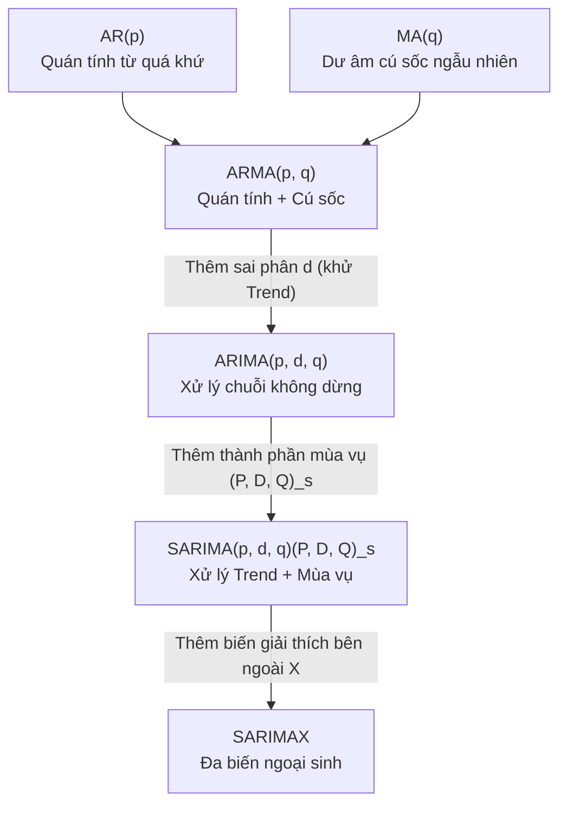

# TỔNG QUAN CHUYÊN SÂU: GIA ĐÌNH MÔ HÌNH THỜI GIAN (AR, MA, ARMA, ARIMA, SARIMA, SARIMAX)
> **Cơ sở lý thuyết toán học – Ý nghĩa tham số – So sánh toàn diện – Ví dụ thực tiễn trực quan**

---

## MỤC LỤC
1. [Bản chất cốt lõi: Tại sao phải xây dựng mô hình chuỗi thời gian?](#1-bản-chất-cốt-lõi-tại-sao-phải-xây-dựng-mô-hình-chuỗi-thời-gian)
2. [Chi tiết từng mô hình: Công thức, Ý nghĩa tham số & Điều kiện hoạt động](#2-chi-tiết-từng-mô-hình-công-thức-ý-nghĩa-tham-số--điều-kiện-hoạt-động)
   - 2.1. Mô hình Tự hồi quy: $\text{AR}(p)$
   - 2.2. Mô hình Trung bình trượt: $\text{MA}(q)$
   - 2.3. Mô hình kết hợp Tự hồi quy & Trung bình trượt: $\text{ARMA}(p, q)$
   - 2.4. Mô hình Tự hồi quy Tích hợp Trung bình trượt: $\text{ARIMA}(p, d, q)$
   - 2.5. Mô hình Tự hồi quy Tích hợp Mùa vụ: $\text{SARIMA}(p, d, q)(P, D, Q)_s$
   - 2.6. Mô hình SARIMA kết hợp Biến ngoại sinh: $\text{SARIMAX}$
3. [Bảng so sánh đối chiếu toàn diện giữa các mô hình](#3-bảng-so-sánh-đối-chiếu-toàn-diện-giữa-các-mô-hình)
4. [Các ví dụ thực tế cực kỳ dễ hiểu (Intuitive Real-world Examples)](#4-các-ví-dụ-thực-tế-cực-kỳ-dễ-hiểu-intuitive-real-world-examples)
   - Ví dụ 1: Nhiệt độ phòng khách và Hiện tượng Quán tính ($\text{AR}$)
   - Ví dụ 2: Giá cổ phiếu và Cú sốc tin tức bất ngờ ($\text{MA}$)
   - Ví dụ 3: Chỉ số giá tiêu dùng CPI / Giá vàng ($\text{ARIMA}$)
   - Ví dụ 4: Doanh số đồ bơi / Vé máy bay du lịch hè ($\text{SARIMA}$)
   - Ví dụ 5: Nhu cầu tiêu thụ điện lưới quốc gia ($\text{SARIMAX}$)
5. [Cây quyết định: Khi nào nên dùng mô hình nào?](#5-cây-quyết-định-khi-nào-nên-dùng-mô-hình-nào)

---

# 1. BẢN CHẤT CỐT LÕI: TẠI SAO PHẢI XÂY DỰNG MÔ HÌNH CHUỖI THỜI GIAN?

Trong học máy truyền thống (Machine Learning), dữ liệu thường được giả định là **i.i.d** (*Independent and Identically Distributed* - Độc lập và có cùng phân phối). Mỗi dòng dữ liệu không quan tâm đến dòng trước hay dòng sau.

Tuy nhiên, **Chuỗi thời gian ($y_t$) hoàn toàn phá vỡ giả định này**:
- Giá trị hôm nay ($y_t$) phụ thuộc mật thiết vào giá trị hôm qua ($y_{t-1}$), tuần trước ($y_{t-7}$), hoặc cùng kỳ năm ngoái ($y_{t-s}$).
- Ta không thể "trộn ngẫu nhiên" (shuffle) các mốc thời gian.
- **Mục tiêu của gia đình mô hình Box-Jenkins (AR, MA, ARIMA, SARIMA)** là: **Tách chuỗi thời gian thành các thành phần có quy luật toán học (Quán tính, Cú sốc ngẫu nhiên, Xu hướng, Mùa vụ) sao cho phần còn sót lại cuối cùng (Phần dư - Residual) chỉ là Nhiễu trắng ngẫu nhiên thuần túy (White Noise)**.

---

# 2. CHI TIẾT TỪNG MÔ HÌNH: CÔNG THỨC, Ý NGHĨA THAM SỐ & ĐIỀU KIỆN HOẠT ĐỘNG



---

## 2.1. Mô hình Tự hồi quy: $\text{AR}(p)$ (Autoregressive Model)

### Khái niệm & Trực giác (Intuition)
"Tự hồi quy" (Auto-regression) nghĩa là tự hồi quy chính mình trên quá khứ. Giá trị tại thời điểm hiện tại $y_t$ là một hàm tuyến tính của $p$ giá trị trong quá khứ ($y_{t-1}, y_{t-2}, \dots, y_{t-p}$) cộng với một sai số ngẫu nhiên mới phát sinh.

### Phương trình toán học
$$y_t = c + \phi_1 y_{t-1} + \phi_2 y_{t-2} + \dots + \phi_p y_{t-p} + \epsilon_t$$
Hoặc viết gọn qua toán tử trễ $B$ ($B^k y_t = y_{t-k}$):
$$\Phi_p(B) y_t = c + \epsilon_t \quad \text{với } \Phi_p(B) = 1 - \phi_1 B - \phi_2 B^2 - \dots - \phi_p B^p$$

Trong đó:
- $c$: Hằng số (liên quan đến giá trị trung bình dài hạn $\mu = \frac{c}{1 - \sum \phi_i}$).
- $p$: Bậc tự hồi quy (số bước trễ quá khứ được sử dụng).
- $\phi_1, \dots, \phi_p$: Các trọng số tự hồi quy.
- $\epsilon_t \sim \mathcal{WN}(0, \sigma^2)$: Nhiễu trắng (White noise) tại thời điểm $t$.

### Điều kiện Dừng (Stationarity Condition)
Để mô hình $\text{AR}(p)$ dừng, mọi nghiệm của phương trình đặc trưng $\Phi_p(z) = 0$ phải nằm **ngoài vòng tròn đơn vị** (nghĩa là $|z_i| > 1$).  
- *Ví dụ cho $\text{AR}(1)$:* $y_t = c + \phi_1 y_{t-1} + \epsilon_t$. Điều kiện dừng bắt buộc là **$|\phi_1| < 1$**.
  - Nếu $\phi_1 = 1$: Trở thành bước đi ngẫu nhiên (*Random Walk*), chuỗi không dừng.
  - Nếu $|\phi_1| > 1$: Chuỗi phát nổ (*Explosive*), giá trị tiến ra vô cực.

---

## 2.2. Mô hình Trung bình trượt: $\text{MA}(q)$ (Moving Average Model)

> [!CAUTION]
> **Tránh nhầm lẫn:** Mô hình $\text{MA}(q)$ trong kinh tế lượng/chuỗi thời gian **KHÔNG PHẢI** là đường làm mượt trung bình động giản đơn (Rolling Moving Average) như trong phân tích kỹ thuật chứng khoán (MA20, MA50).

### Khái niệm & Trực giác (Intuition)
$\text{MA}(q)$ mô hình hóa giá trị hiện tại $y_t$ dựa trên **dư âm của các cú sốc ngẫu nhiên (sai số dự báo) trong quá khứ**. Khi một cú sốc xảy ra hôm nay, tác động của nó không biến mất ngay lập tức mà tiếp tục lay động hệ thống trong $q$ chu kỳ tiếp theo trước khi tan biến hoàn toàn.

### Phương trình toán học
$$y_t = \mu + \epsilon_t + \theta_1 \epsilon_{t-1} + \theta_2 \epsilon_{t-2} + \dots + \theta_q \epsilon_{t-q}$$
Dạng toán tử trễ:
$$y_t = \mu + \Theta_q(B)\epsilon_t \quad \text{với } \Theta_q(B) = 1 + \theta_1 B + \theta_2 B^2 + \dots + \theta_q B^q$$

Trong đó:
- $\mu$: Giá trị trung bình kỳ vọng của chuỗi.
- $q$: Bậc trung bình trượt (độ dài ghi nhớ của cú sốc).
- $\theta_1, \dots, \theta_q$: Hệ số phản ánh mức độ lan truyền của cú sốc.
- $\epsilon_t, \epsilon_{t-1}, \dots$: Các cú sốc ngẫu nhiên (nhiễu trắng).

### Đặc tính & Điều kiện Khả nghịch (Invertibility Condition)
- **Tính dừng:** Mô hình $\text{MA}(q)$ **luôn luôn dừng** với mọi giá trị của $\theta$, vì nó chỉ là tổ hợp tuyến tính của các biến ngẫu nhiên dừng $\epsilon_t$.
- **Tính khả nghịch (Invertibility):** Để mô hình $\text{MA}$ có thể quy đổi tương đương sang một mô hình $\text{AR}(\infty)$, các nghiệm của phương trình $\Theta_q(z) = 0$ phải nằm ngoài vòng tròn đơn vị.
  - *Ví dụ cho $\text{MA}(1)$:* Bắt buộc **$|\theta_1| < 1$**. Điều này đảm bảo rằng các cú sốc xảy ra trong quá khứ càng xa thì ảnh hưởng đến hiện tại càng nhỏ dần về 0.

---

## 2.3. Mô hình Tự hồi quy Trung bình trượt: $\text{ARMA}(p, q)$

### Khái niệm
Kết hợp cả hai thành phần: Chuỗi vừa chịu sự chi phối bởi **quán tính giá trị quá khứ** ($\text{AR}$), vừa chịu ảnh hưởng bởi **dư âm của các cú sốc ngẫu nhiên** ($\text{MA}$).

### Phương trình toán học
$$y_t = c + \phi_1 y_{t-1} + \dots + \phi_p y_{t-p} + \epsilon_t + \theta_1 \epsilon_{t-1} + \dots + \theta_q \epsilon_{t-q}$$
Dạng toán tử trễ:
$$\Phi_p(B) y_t = c + \Theta_q(B)\epsilon_t$$

> [!NOTE]
> Mô hình $\text{ARMA}(p, q)$ **chỉ áp dụng được trên chuỗi thời gian ĐÃ DỪNG (Stationary)**. Nếu dữ liệu có Trend hoặc Seasonality, $\text{ARMA}$ sẽ thất bại.

---

## 2.4. Mô hình $\text{ARIMA}(p, d, q)$ (Autoregressive Integrated Moving Average)

### Khái niệm
Chữ **$I$ (Integrated - Tích hợp)** đại diện cho thao tác **Sai phân ($d$)**. Đây là bước đột phá của Box và Jenkins: Thay vì bắt buộc chuỗi thô phải dừng, mô hình cho phép nhận vào chuỗi có xu hướng không dừng, tự động lấy sai phân $d$ lần để chuỗi dừng, áp dụng $\text{ARMA}(p, q)$, rồi tích hợp ngược lại để dự báo giá trị gốc.

### Phương trình toán học
Gọi $y'_t = (1 - B)^d y_t$ là chuỗi sau khi lấy sai phân bậc $d$:
$$\Phi_p(B) (1 - B)^d y_t = c + \Theta_q(B)\epsilon_t$$

### Ý nghĩa bộ tham số $(p, d, q)$
1. **$d$ (Differencing Order - Bậc sai phân):**
   - $d=0$: Chuỗi gốc đã dừng, không cần sai phân.
   - $d=1$: Chuỗi có xu hướng tuyến tính (Linear Trend) $\rightarrow$ lấy hiệu số $y_t - y_{t-1}$ để đưa về hằng số.
   - $d=2$: Chuỗi có xu hướng parabol/bậc 2 $\rightarrow$ lấy sai phân 2 lần. (Hiếm khi dùng $d \ge 2$).
2. **$p$ (AR Order - Bậc tự hồi quy):** Số bước trễ sai phân quá khứ tác động trực tiếp lên biến động hiện tại.
3. **$q$ (MA Order - Bậc trung bình trượt):** Số sai số dự báo quá khứ điều chỉnh biến động hiện tại.

---

## 2.5. Mô hình $\text{SARIMA}(p, d, q)(P, D, Q)_s$ (Seasonal ARIMA)

### Khái niệm
Khi chuỗi thời gian vừa có xu hướng, vừa có **chu kỳ lặp lại theo mùa (Seasonality)** (ví dụ: chu kỳ 12 tháng hàng năm, hoặc chu kỳ 7 ngày trong tuần), mô hình ARIMA thuần sẽ thất bại vì không thể bắt được tương quan giữa $y_t$ và $y_{t-s}$. $\text{SARIMA}$ bổ sung một cấu trúc tương tự ở cấp độ mùa vụ.

### Phương trình toán học
$$\Phi_p(B) \mathbf{\Phi_P(B^s)} (1 - B)^d \mathbf{(1 - B^s)^D} y_t = c + \Theta_q(B) \mathbf{\Theta_Q(B^s)} \epsilon_t$$

### Ý nghĩa của toàn bộ 7 tham số:
- **$(p, d, q)$**: Các tham số phi mùa vụ (Non-seasonal components) mô tả sự tương quan giữa các mốc thời gian liền kề ($t, t-1, t-2$).
- **$s$ (Seasonal Period - Độ dài chu kỳ mùa vụ):** 
  - $s = 12$: Dữ liệu theo tháng, chu kỳ lặp lại hàng năm.
  - $s = 4$: Dữ liệu theo quý.
  - $s = 7$: Dữ liệu theo ngày, chu kỳ lặp lại hàng tuần (thứ Hai $\rightarrow$ Chủ Nhật).
  - $s = 24$: Dữ liệu theo giờ, chu kỳ lặp lại trong ngày.
- **$D$ (Seasonal Differencing - Bậc sai phân mùa vụ):**
  - $\Delta_s y_t = y_t - y_{t-s} = (1 - B^s)y_t$.
  - Triệt tiêu dao động hình sin của tính mùa vụ, so sánh tháng này với cùng kỳ năm ngoái.
- **$P$ (Seasonal AR - Tự hồi quy mùa vụ):** Mức độ phụ thuộc vào giá trị của cùng kỳ những chu kỳ trước ($y_{t-s}, y_{t-2s}, \dots$).
- **$Q$ (Seasonal MA - Trung bình trượt mùa vụ):** Dư âm sai số của cùng kỳ các chu kỳ trước ($\epsilon_{t-s}, \epsilon_{t-2s}, \dots$).

---

## 2.6. Mô hình $\text{SARIMAX}$ (SARIMA with eXogenous variables)

### Khái niệm
Các mô hình trên là mô hình **đơn biến (Univariate)**: Chỉ dùng quá khứ của chính chuỗi $y$ để dự báo $y$.  
Tuy nhiên, trong thực tế, $y_t$ còn bị tác động mạnh mẽ bởi các **yếu tố bên ngoài (Exogenous Variables - $X_t$)** như: chiến dịch quảng cáo, thời tiết, giá dầu, ngày lễ tết,... $\text{SARIMAX}$ kết hợp hồi quy tuyến tính đa biến với cấu trúc sai số có dạng SARIMA:

### Phương trình toán học
$$y_t = \beta_1 X_{1, t} + \beta_2 X_{2, t} + \dots + \beta_k X_{k, t} + \eta_t$$
Trong đó $\eta_t$ là phần dư không độc lập mà tuân theo quá trình $\text{SARIMA}(p, d, q)(P, D, Q)_s$:
$$\Phi_p(B) \Phi_P(B^s) (1 - B)^d (1 - B^s)^D \eta_t = \Theta_q(B) \Theta_Q(B^s) \epsilon_t$$

---

# 3. BẢNG SO SÁNH ĐỐI CHIẾU TOÀN DIỆN GIỮA CÁC MÔ HÌNH

| Đặc tính so sánh | AR($p$) | MA($q$) | ARMA($p, q$) | ARIMA($p, d, q$) | SARIMA($p,d,q$)($P,D,Q$)$_s$ | SARIMAX |
| :--- | :---: | :---: | :---: | :---: | :---: | :---: |
| **Yêu cầu dữ liệu gốc phải dừng?** | **Bắt buộc** | **Bắt buộc** | **Bắt buộc** | **Không cần** (nhờ có $d$) | **Không cần** (nhờ $d, D$) | **Không cần** |
| **Xử lý được Xu hướng (Trend)?** | Không | Không | Không | **Tốt** (nhờ $d=1, 2$) | **Tốt** | **Tốt** |
| **Xử lý được Mùa vụ (Seasonality)?** | Rất yếu | Rất yếu | Kém | Kém (chỉ bắt được trend) | **Xuất sắc** | **Xuất sắc** |
| **Sử dụng biến ngoại sinh ($X$)?** | Không | Không | Không | Không | Không | **Có** |
| **Bản chất động lực** | Quán tính từ giá trị quá khứ | Dư âm của các cú sốc ngẫu nhiên | Cả quán tính lẫn cú sốc | Quán tính + cú sốc trên tốc độ thay đổi | Tương quan kép: ngắn hạn + cùng kỳ mùa vụ | Tương quan thời gian + tác động biến ngoại lai |
| **Dấu hiệu trên PACF** | **Cắt cụt sau lag $p$** | Giảm dần | Giảm dần | Cắt cụt sau lag $p$ (trên chuỗi sai phân) | Cắt cụt tại lag $p$ và lag $P \times s$ | Xem trên phần dư hồi quy |
| **Dấu hiệu trên ACF** | Giảm dần | **Cắt cụt sau lag $q$** | Giảm dần | Cắt cụt sau lag $q$ (trên chuỗi sai phân) | Cắt cụt tại lag $q$ và lag $Q \times s$ | Xem trên phần dư hồi quy |
| **Dự báo dài hạn** | Tiệm cận về $\mu$ | Bằng $\mu$ sau $q$ bước | Tiệm cận về $\mu$ | Đi theo đường xu hướng $d$ | Tái tạo hoàn hảo các sóng chu kỳ tương lai | Đi theo xu hướng + dự báo của biến $X$ |

---

# 4. CÁC VÍ DỤ THỰC TẾ CỰC KỲ DỄ HIỂU (INTUITIVE REAL-WORLD EXAMPLES)

---

### Ví dụ 1: Nhiệt độ phòng khách và Hiện tượng Quán tính $\implies$ Mô hình $\text{AR}(1)$
- **Bối cảnh:** Bạn đang theo dõi nhiệt độ trong phòng khách có bật máy sưởi.
- **Cơ chế:** Nếu lúc 14:00 phòng đang ấm $28^\circ\text{C}$, thì lúc 14:01 nhiệt độ chắc chắn sẽ xoay quanh $28^\circ\text{C}$ (nó không thể đột ngột rơi xuống $15^\circ\text{C}$). 
- **Mô hình hóa:**
  $$\text{Nhiệt độ}(t) = 0.95 \times \text{Nhiệt độ}(t-1) + \text{Nhiễu}(t)$$
  Hệ số $\phi_1 = 0.95$ đại diện cho **quán tính nhiệt** của căn phòng. Nhiệt độ quá khứ nắm giữ 95% thông tin của nhiệt độ kế tiếp.

---

### Ví dụ 2: Giá cổ phiếu và Cú sốc tin tức bất ngờ $\implies$ Mô hình $\text{MA}(1)$
- **Bối cảnh:** Biến động giá của một cổ phiếu công nghệ quanh mức giá cân bằng 100 USD.
- **Cơ chế:**
  - Hôm nay công ty bất ngờ bị phạt một khoản thuế lớn $\implies$ một cú sốc âm $\epsilon_t = -10$ xuất hiện.
  - Ngày hôm sau, thị trường vẫn chưa hết bàng hoàng, dư âm của tin tức hôm qua vẫn khiến giá bị ghìm xuống một lượng $\theta_1 \epsilon_{t-1} = 0.4 \times (-10) = -4$ USD.
  - Nhưng sang đến ngày thứ 3, dư âm đã tiêu tan hoàn toàn.
- **Mô hình hóa:**
  $$y_t = 100 + \epsilon_t + 0.4 \epsilon_{t-1}$$
  Mô hình $\text{MA}(1)$ giải thích hoàn hảo vì sao một cú sốc chỉ rung lắc hệ thống trong đúng 1 bước trễ rồi triệt tiêu.

---

### Ví dụ 3: Chỉ số giá tiêu dùng (CPI) hoặc Doanh thu tích lũy $\implies$ Mô hình $\text{ARIMA}(1, 1, 1)$
- **Bối cảnh:** Chỉ số CPI hoặc doanh số một chuỗi siêu thị tăng trưởng không ngừng qua các năm (Non-stationary, có Trend đi lên).
- **Vì sao ARMA thất bại?** Vì giá trị trung bình tháng sau luôn cao hơn tháng trước. Nếu dùng ARMA trực tiếp, sai số sẽ nổ tung.
- **Cách ARIMA giải quyết:**
  1. **Bước $I(d=1)$:** Không dự báo trực tiếp giá trị CPI tuyệt đối. Hãy lấy **Mức tăng CPI = $\text{CPI}_t - \text{CPI}_{t-1}$**. Chuỗi "mức tăng" này đã dừng và dao động quanh mức $0.3\%$/tháng.
  2. **Bước $AR(1)$:** Mức tăng trưởng tháng này chịu ảnh hưởng từ mức tăng trưởng tháng trước.
  3. **Bước $MA(1)$:** Mức tăng trưởng tháng này được điều chỉnh nếu tháng trước dự báo bị lệch.

---

### Ví dụ 4: Lượng hành khách hàng không / Doanh số bánh Trung thu $\implies$ Mô hình $\text{SARIMA}(1, 1, 1)(1, 1, 1)_{12}$
- **Bối cảnh:** Lượng khách mua vé máy bay (Dataset `AirPassengers` trong bài Lab 2).
- **Hiện tượng thực tế:**
  1. Hàng năm dân số và nhu cầu đi lại tăng lên $\implies$ **Có Trend** (giải quyết bằng sai phân thường $d=1$).
  2. Cứ đến tháng 7 và tháng 8 (mùa hè học sinh nghỉ lễ), số lượng khách tăng vọt gấp đôi so với các tháng khác; đến tháng 11 lại giảm sâu $\implies$ **Có Seasonality $s=12$** lặp lại đều đặn hàng năm.
- **Vì sao ARIMA thuần thất bại?**
  - ARIMA thuần chỉ biết rằng "trung bình mỗi tháng tăng thêm vài ngàn khách", nên nó vẽ ra một đường dự báo thẳng đuột hướng lên. Nó hoàn toàn bất ngờ khi tháng 7 khách tăng vọt và tháng 11 khách tụt dốc $\implies$ Sai số khổng lồ ($\text{RMSE} = 96.33$).
- **SARIMA làm gì?**
  - Thực hiện sai phân mùa vụ $D=1$: Lấy lượng khách tháng 7 năm nay so sánh với tháng 7 năm ngoái.
  - Đưa vào hệ số $P=1, Q=1$ tại lag 12 để mô hình học được: "Tháng 7 năm nay sẽ có bước sóng tương đồng với tháng 7 năm ngoái" $\implies$ Sai số giảm về mức gần như bằng 0 ($\text{RMSE} = 15.25$).

---

### Ví dụ 5: Nhu cầu tiêu thụ điện lưới giờ cao điểm $\implies$ Mô hình $\text{SARIMAX}$
- **Bối cảnh:** Công ty Điện lực Quốc gia dự báo công suất tiêu thụ điện (MW) theo từng giờ.
- **Các yếu tố đan xen:**
  1. **Tính mùa vụ kép ($s=24$ giờ và $s=168$ giờ - tuần):** Ban ngày dùng nhiều hơn ban đêm; ngày trong tuần dùng nhiều hơn thứ Bảy/Chủ Nhật.
  2. **Yếu tố ngoại sinh quyết định ($X_t$):** **Nhiệt độ ngoài trời ($^\circ\text{C}$)**. Vào mùa hè, nếu nhiệt độ vọt lên $39^\circ\text{C}$, tất cả máy điều hòa đều bật hết công suất $\implies$ Tiêu thụ điện tăng vọt không theo quy luật thông thường.
- **Giải pháp SARIMAX:**
  $$\text{Điện tiêu thụ}_t = \beta \times \text{Nhiệt độ}_t + \gamma \times \text{Là ngày lễ}_t + \eta_t$$
  với $\eta_t$ được lọc sạch bởi mô hình $\text{SARIMA}$.

---

# 5. CÂY QUYẾT ĐỊNH: KHI NÀO NÊN DÙNG MÔ HÌNH NÀO?

Hãy làm theo các bước tra cứu sau khi đối mặt với một bài toán thực tế:

```
                      [DỮ LIỆU CHUỖI THỜI GIAN]
                                  │
                   Chuỗi đã dừng (Stationary)?
                   (Kiểm tra qua biểu đồ & ADF test)
                                  │
                 ┌────────────────┴────────────────┐
                 ▼ (CÓ: p < 0.05)                  ▼ (KHÔNG: p >= 0.05)
         Có yếu tố mùa vụ?                 Có yếu tố mùa vụ (Seasonality)?
                 │                                 │
         ┌───────┴───────┐                 ┌───────┴───────┐
         ▼ (Không)       ▼ (Có)            ▼ (Không)       ▼ (Có)
       ARMA(p, q)     SARMA(...)         ARIMA(p, d, q)   SARIMA(p, d, q)(P, D, Q)_s
  (hoặc AR, MA thuần)                     (chọn d=1, 2)    (chọn d=1, D=1, xác định s)
                                                           │
                                           Có thêm biến ngoại sinh (Nhiệt độ, Sự kiện)?
                                                           │
                                                   ┌───────┴───────┐
                                                   ▼ (Không)       ▼ (Có)
                                                SARIMA          SARIMAX
```

---

## TỔNG KẾT BÀI HỌC CỐT LÕI

1. **AR**: Nắm bắt **Quán tính** (Hôm qua thế nào thì hôm nay có xu hướng như thế).
2. **MA**: Nắm bắt **Cú sốc** (Tin tức bất ngờ gây chấn động trong vài kỳ rồi tắt).
3. **ARMA**: Dành cho thế giới lý tưởng nơi chuỗi thời gian đã **Dừng**.
4. **ARIMA**: Dành cho thế giới thực tế nơi dữ liệu có **Xu hướng tăng/giảm** dài hạn (dùng $d$ để đưa về dừng).
5. **SARIMA**: Dành cho dữ liệu thực tế vừa có xu hướng, vừa có **Mùa vụ chu kỳ** lặp lại (dùng thêm $D, P, Q, s$).
6. **SARIMAX**: Khi chuỗi thời gian còn bị chi phối bởi các **Tác nhân ngoại cảnh đo đếm được**.
