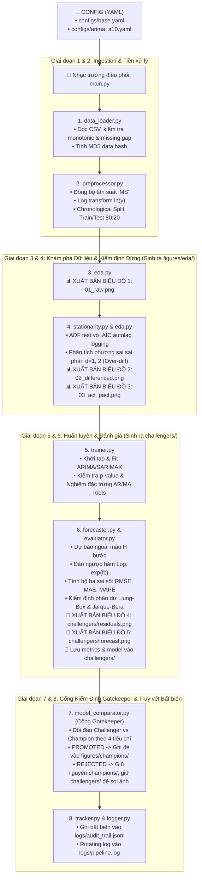

# KỊCH BẢN THUYẾT TRÌNH TOÀN DIỆN LAB 2: KIẾN TRÚC PIPELINE MLOPS & QUY TRÌNH HỒI QUY CHUỖI THỜI GIAN BOX-JENKINS

**Khóa học:** Phân tích Chuỗi thời gian (Time Series Analysis)  
**Thời lượng chuẩn:** 12 – 15 phút  
**Tập dữ liệu thực nghiệm:**
1. `Dataset 1 (a10.csv)`: Doanh số bán lẻ dược phẩm trị tiểu đường tại Úc (204 tháng: 1991 – 2008).
2. `Dataset 2 (AirPassengers.csv)`: Lượng hành khách hàng không quốc tế (144 tháng: 1949 – 1960).  

---

## 📑 BỐ CỤC BÀI THUYẾT TRÌNH (AGENDA)
1. **Phần 1 (00:00 – 03:00):** Kiến trúc Time Series Pipeline MLOps & Thứ tự thực hiện tuần tự để sinh ra từng biểu đồ/tài sản.
2. **Phần 2 (03:00 – 10:30):** Thực nghiệm Bài toán 1 (`a10` - ARIMA): Chuỗi liên kết nhân quả từ EDA $\rightarrow$ ADF $\rightarrow$ Sai phân $\rightarrow$ ACF/PACF $\rightarrow$ Huấn luyện $\rightarrow$ Chẩn đoán phần dư & Dự báo ngoài mẫu.
3. **Phần 3 (10:30 – 12:30):** Nâng cấp Bài toán 2 (`AirPassengers` - SARIMA): Phá vỡ bế tắc mùa vụ, giảm 84% sai số so với ARIMA thuần.
4. **Phần 4 (12:30 – 15:00):** Cơ chế Quản trị Mô hình & Cổng Kiểm Định Champion vs Challenger: So sánh song song và giải quyết bài toán chống phình to dữ liệu.

---

# PHẦN 1: TỔNG QUAN KIẾN TRÚC PIPELINE & THỨ TỰ THỰC THI TUẦN TỰ (00:00 – 03:00)

### 🎙️ Lời thoại trình bày:
> "Kính thưa Thầy/Cô và các bạn,  
> Hôm nay nhóm em xin trình bày báo cáo thực hành **Lab 2: Kiểm định ADF và Mô hình hóa Chuỗi Thời Gian với ARIMA & SARIMA**.
>
> Thay vì thực hiện rời rạc trên Jupyter Notebook với nguy cơ rò rỉ dữ liệu (*Data Leakage*) và khó tái lập thí nghiệm (*Lack of Reproducibility*), nhóm em đã đóng gói toàn bộ quy trình toán học Box-Jenkins thành một **Production-Grade Time Series Pipeline** chuẩn công nghiệp.
>
> *(Hành động: Chiếu sơ đồ kiến trúc Pipeline trên màn hình)*



> **Nguyên tắc cốt lõi của Kiến trúc Pipeline:**
> 1. **Cấu hình Declarative qua YAML ([lab2/configs/arima_a10.yaml](file:///home/thanhlong/Documents/TimeSeries/lab2/configs/arima_a10.yaml)):** Code Python được đóng băng bất biến. Toàn bộ tham số từ tần suất ngày tháng `MS`, tỷ lệ cắt tập kiểm thử `train_ratio: 0.8`, cờ biến đổi log `apply_log: false`, đến bộ tham số `order: [1, 1, 1]` đều nằm trong config. Khi muốn thử nghiệm giả thuyết mới, ta chỉ cần sửa file config mà không cần động vào code lõi.
> 2. **Cấu trúc Thư mục Tài sản Phân cấp Rõ ràng ([lab2/artifacts/](file:///home/thanhlong/Documents/TimeSeries/lab2/artifacts)):**
>    - `figures/eda/`: Chứa các biểu đồ phân tích dữ liệu thuần túy (chưa hề có mô hình nào).
>    - `figures/champions/` & `models/champions/` & `metrics/champions/`: Chứa tài sản của **mô hình TỐT NHẤT từ trước đến nay**.
>    - `figures/challengers/` & `models/challengers/` & `metrics/challengers/`: Chứa tài sản của **lần chạy thử nghiệm vừa thực hiện** để Data Scientist đối chiếu trực quan song song.
>
> Sau đây, em xin đưa Thầy/Cô đi qua thứ tự thực thi thực tế từng giai đoạn trên bài toán số 1."

---

# PHẦN 2: THỰC NGHIỆM BÀI TOÁN 1 (`a10` - ARIMA) VỚI SỐ LIỆU MỚI NHẤT (03:00 – 10:30)

---

## 🎙️ GIAI ĐOẠN 1: Nạp Dữ Liệu & Tiền Xử Lý — Bảo Đảm Tính Toàn Vẹn
* **Module chịu trách nhiệm:** [data_loader.py](file:///home/thanhlong/Documents/TimeSeries/lab2/src/data_loader.py) & [preprocessor.py](file:///home/thanhlong/Documents/TimeSeries/lab2/src/preprocessor.py)
* **Số liệu thực tế mới nhất trích xuất từ log:**
  ```text
  [INFO] Ingesting raw dataset: path=lab2/data/raw/a10.csv, md5=66f06c62d8be4aea653eab499fb42b23
  [INFO] Dataset loaded: rows=204, columns=['date', 'value']
  [INFO] Data Validation: time_span=1991-07 to 2008-06, monotonic=True, freq=MS, missing_gaps=0, nulls=0
  [INFO] Train/Test split: total=204, train=163 (1991-07 -> 2005-01), test=41 (2005-02 -> 2008-06)
  ```

> **Lời thoại:**  
> "Khi lệnh `python3 lab2/main.py --config lab2/configs/arima_a10.yaml` được khởi chạy:
> - Đầu tiên, module `data_loader.py` tiến hành băm mã **MD5 checksum = `66f06c62...`** để đảm bảo dữ liệu đầu vào không bị sửa đổi ngoài ý muốn. Nó kiểm tra chuỗi thời gian đảm bảo tính đơn điệu tăng dần (*monotonic increasing*), không có giá trị khuyết thiếu (*0 nulls*) và không bị đứt gãy tháng (*0 gaps*).
> - Tiếp theo, module `preprocessor.py` ép tần suất đầu tháng `freq='MS'` và thực hiện **Chronological Split** (cắt tuần tự theo thời gian, tuyệt đối không xáo trộn Shuffle nhằm chống rò rỉ tương lai): Tập Train gồm **163 tháng** (từ 07/1991 đến 01/2005) và tập Test ngoài mẫu gồm **41 tháng** (từ 02/2005 đến 06/2008)."

---

## 🎙️ GIAI ĐOẠN 2: Khám Phá EDA Chuỗi Gốc — Xuất Bản Biểu Đồ 1
* **Module chịu trách nhiệm:** [eda.py](file:///home/thanhlong/Documents/TimeSeries/lab2/src/eda.py)
* **Tài sản xuất bản:** [lab2/artifacts/figures/eda/a10_arima_baseline_eda_01_raw.png](file:///home/thanhlong/Documents/TimeSeries/lab2/artifacts/figures/eda/a10_arima_baseline_eda_01_raw.png)

*(Hành động: Chiếu tệp biểu đồ `01_raw.png` trong thư mục `figures/eda/`)*

> **Lời thoại:**  
> "Ngay sau bước tiền xử lý, module `eda.py` tự động vẽ và lưu bức ảnh đầu tiên vào thư mục `figures/eda/`.  
> Nhìn vào biểu đồ chuỗi gốc:
> 1. **Xu hướng tăng trưởng dốc đứng (Upward Trend):** Doanh số bắt đầu ở mức đáy **2.81 triệu USD**, liên tục leo dốc qua 17 năm và lập đỉnh cao nhất lịch sử **29.67 triệu USD**. Mức trung bình chuỗi là **10.69 triệu USD**, với biên độ dao động $\pm 1\text{ Std}$ trải từ $4.96$ đến $16.42$ triệu USD.
> 2. **Tính chu kỳ mùa vụ 12 tháng lặp lại rất đều:** Cứ đến tháng 12 và tháng 1, doanh số lại dựng đỉnh nhọn do nhu cầu tích trữ thuốc cuối năm và chính sách bảo hiểm PBS của Úc, sau đó sang tháng 2 thì rơi mạnh chạm đáy.
>
> 👉 **MẮT XÍCH CHUYỂN TIẾP (Bridge Question):**  
> Trực giác cho thấy chuỗi có mức trung bình dốc đứng và phương sai mở rộng thì **rõ ràng là KHÔNG DỪNG (Non-stationary)**.  
> *Tuy nhiên, trong kinh tế lượng, trực giác là chưa đủ. Làm sao chứng minh bằng kiểm định toán học định lượng?*  
> $\implies$ **Pipeline kích hoạt module `stationarity.py` để chạy kiểm định ADF!**"

---

## 🎙️ GIAI ĐOẠN 3: Kiểm Định ADF & Cơ Chế Autolag AIC — Khẳng Định Toán Học
* **Module chịu trách nhiệm:** [stationarity.py](file:///home/thanhlong/Documents/TimeSeries/lab2/src/stationarity.py)
* **Số liệu thực tế trích xuất từ log:**
  ```text
  [INFO] --- ADF Test [a10_arima_baseline (Train Raw)] Autolag Evaluation (Criterion: AIC) ---
  [INFO]    Candidate Lag  0: AIC=  568.2089
  ...
  [INFO]    Candidate Lag 14: AIC=  262.0001 [MINIMUM AIC - SELECTED]
  [INFO] ADF Result: stat=+2.2309, p_value=0.9989, used_lag=14/14, crit_5%=-2.8813 -> NON-STATIONARY
  ```

> **Lời thoại:**  
> "Module `stationarity.py` thực hiện kiểm định nghiệm đơn vị Augmented Dickey-Fuller trên tập Train:
> - **Giả thuyết:** $H_0: \gamma = 0$ (Chuỗi chứa nghiệm đơn vị $\rightarrow$ **Không dừng**).  
> - **Cơ chế Autolag AIC minh bạch:** Hệ thống tự động duyệt qua 15 bậc trễ candidate (từ 0 đến 14). Tại Lag 14, điểm AIC đạt giá trị cực tiểu là **$262.00$**, do đó thuật toán chọn Lag 14 để đảm bảo phần dư phương trình ADF triệt tiêu hoàn toàn tự tương quan.
> - **Kết luận toán học:**  
>   - Thống kê $ADF = \mathbf{+2.2309}$, lớn hơn rất nhiều so với ngưỡng tới hạn $5\%$ là **$-2.8813$** (muốn dừng thì ADF phải âm hơn $-2.8813$).  
>   - Giá trị $p\text{-value} = \mathbf{0.9989} \approx 1.0 \gg 0.05$.
>
> 👉 **MẮT XÍCH CHUYỂN TIẾP:**  
> Không thể bác bỏ $H_0$, **chuỗi gốc khẳng định 100% là KHÔNG DỪNG**.  
> *Chuỗi không dừng thì không thể fit mô hình ARMA. Phải làm gì để triệt tiêu xu hướng đưa chuỗi về dừng?*  
> $\implies$ **Pipeline chuyển sang phân tích sai phân và xuất bản Biểu đồ 2!**"

---

## 🎙️ GIAI ĐOẠN 4: Phân Tích Sai Phân & Nhận Diện Bậc Box-Jenkins — Xuất Bản Biểu Đồ 2 & 3
* **Module chịu trách nhiệm:** [stationarity.py](file:///home/thanhlong/Documents/TimeSeries/lab2/src/stationarity.py) kết hợp [eda.py](file:///home/thanhlong/Documents/TimeSeries/lab2/src/eda.py)
* **Tài sản xuất bản:**
  - Biểu đồ 2: [lab2/artifacts/figures/eda/a10_arima_baseline_eda_02_differenced.png](file:///home/thanhlong/Documents/TimeSeries/lab2/artifacts/figures/eda/a10_arima_baseline_eda_02_differenced.png)
  - Biểu đồ 3: [lab2/artifacts/figures/eda/a10_arima_baseline_eda_03_acf_pacf.png](file:///home/thanhlong/Documents/TimeSeries/lab2/artifacts/figures/eda/a10_arima_baseline_eda_03_acf_pacf.png)

*(Hành động: Chiếu Biểu đồ 2 `02_differenced.png`)*

> **Lời thoại:**  
> "Để tìm bậc sai phân $d$, pipeline kích hoạt **Bẫy kiểm soát quá sai phân (Over-differencing Safeguard)**:
> - **Khi lấy $d=1$ (Đồ thị xanh lá phía trên):** Phương sai chuỗi **giảm sốc $83.6\%$** (từ $15.52$ xuống còn **$2.54$**), hệ số tự tương quan bậc 1 là $r_1 = -0.320$. Chuỗi đã phẳng hoàn toàn quanh mức 0.
> - **Nếu tiếp tục lấy $d=2$ (Đồ thị xanh mòng két phía dưới):** Phương sai bị dội ngược tăng vọt tới **$+164.6\%$** (từ $2.54$ vọt lên $6.73$), đồng thời $r_1$ tụt xuống **$-0.592 < -0.5$**. Pipeline lập tức bắn cảnh báo `[OVER-DIFFERENCING at d=2]`.  
> $\implies$ **Ta chốt chắc chắn: $d = 1$.**"

*(Hành động: Chiếu tiếp Biểu đồ 3 `03_acf_pacf.png`)*

> "Sau khi có chuỗi dừng $d=1$, module `eda.py` xuất bản tiếp Biểu đồ số 3 để nhận diện bậc $p$ và $q$:
> - **Đồ thị PACF (Bên dưới):** Xuất hiện 2 gai nhọn vọt ra ngoài dải tin cậy tại **Lag 1 và Lag 2**, sau đó tắt hẳn $\implies$ **Gợi ý bậc $p \in \{1, 2\}$**.
> - **Đồ thị ACF (Bên trên):** Hệ số tự tương quan **cắt cụt (cutoff) ngay sau Lag 1** với giá trị âm sâu $\implies$ **Gợi ý bậc $q = 1$**.
>
> 👉 **KHOẢNH KHẮC MẮT XÍCH THEN CHỐT:**  
> Đến đúng giây phút này, chúng ta mới có đầy đủ cơ sở khoa học: $d=1$, $p \in \{1, 2\}$ và $q=1$.  
> $\implies$ **CHỈ ĐẾN BÂY GIỜ, PIPELINE MỚI CHO PHÉP KHỞI TẠO VÀ FIT MÔ HÌNH ARIMA Ở GIAI ĐOẠN 5!**"

---

## 🎙️ GIAI ĐOẠN 5: Huấn Luyện Mô Hình & Thẩm Định Nghiệm Đa Thức
* **Module chịu trách nhiệm:** [trainer.py](file:///home/thanhlong/Documents/TimeSeries/lab2/src/trainer.py)
* **Số liệu thực tế trích xuất từ log:**
  ```text
  [INFO] Training Model: type=ARIMA, order=(1, 1, 1), seasonal_order=None
  Log Likelihood: -288.234 | AIC: 582.468 | BIC: 591.731
  • Nghiệm AR (Min Modulus) : 3.0098 (> 1.0 -> DỪNG (Stationary))
  • Nghiệm MA (Min Modulus) : 1.2408 (> 1.0 -> KHẢ NGHỊCH (Invertible))
  • Tham số có ý nghĩa (p < 0.05): ma.L1 (p=0.0000), sigma2 (p=0.0000)
  • Tham số không ý nghĩa       : ar.L1 (p=0.1603)
  ```

> **Lời thoại:**  
> "Module `trainer.py` tiến hành fit mô hình $\text{ARIMA}(1, 1, 1)$:
> - Điểm số thông tin đạt $AIC = \mathbf{582.47}$, $BIC = \mathbf{591.73}$ (tốt hơn cấu hình $\text{ARIMA}(2,1,1)$ có $AIC=584.46$). Theo nguyên lý tối giản Box-Jenkins (*Occam's Razor*), cấu hình $(1, 1, 1)$ được lựa chọn.
> - Module tự động tính toán mô-đun của các nghiệm đặc trưng:
>   - Nghiệm AR có mô-đun **$3.0098 > 1.0 \implies$ Chuỗi dừng**.
>   - Nghiệm MA có mô-đun **$1.2408 > 1.0 \implies$ Mô hình khả nghịch**.
>
> 👉 **MẮT XÍCH CHUYỂN TIẾP:**  
> Mô hình đã hội tụ về mặt toán học.  
> *Nhưng liệu nó có dự báo chính xác trên tập dữ liệu tương lai Test Set, và phần dư có thực sự sạch nhiễu White Noise?*  
> $\implies$ **Pipeline kích hoạt `forecaster.py` và `evaluator.py` để xuất bản Biểu đồ 4 & 5!**"

---

## 🎙️ GIAI ĐOẠN 6: Dự Báo Ngoài Mẫu & Chẩn Đoán Phần Dư — Xuất Bản Biểu Đồ 4 & 5
* **Module chịu trách nhiệm:** [forecaster.py](file:///home/thanhlong/Documents/TimeSeries/lab2/src/forecaster.py) & [evaluator.py](file:///home/thanhlong/Documents/TimeSeries/lab2/src/evaluator.py)
* **Tài sản xuất bản:**
  - Biểu đồ 4: [lab2/artifacts/figures/champions/a10_arima_baseline_residuals.png](file:///home/thanhlong/Documents/TimeSeries/lab2/artifacts/figures/champions/a10_arima_baseline_residuals.png)
  - Biểu đồ 5: [lab2/artifacts/figures/champions/a10_arima_baseline_forecast.png](file:///home/thanhlong/Documents/TimeSeries/lab2/artifacts/figures/champions/a10_arima_baseline_forecast.png)

*(Hành động: Chiếu Biểu đồ 4 `residuals.png`)*

> **Lời thoại:**  
> "Nhìn vào biểu đồ 4 góc chẩn đoán phần dư do module `evaluator.py` tạo ra:
> - Sai số trung bình $\mu = 0.318 \approx 0$.
> - Phân phối phần dư có $\text{Skewness} = -0.955$, $\text{Kurtosis} = 3.63$.
> - **ĐIỂM NHẬN DIỆN THEN CHỐT TẠI GÓC DƯỚI BÊN TRÁI (Residual ACF):**  
>   - Tại các lag ngắn hạn (Lag 1 đến 10), phần dư nằm gọn trong dải tin cậy 95%, kiểm định Ljung-Box tại Lag 10 có $p\text{-value} = \mathbf{0.3857} > 0.05 \implies$ Đạt chuẩn White Noise ngắn hạn.
>   - **NHƯNG TẠI LAG 12 VÀ LAG 24**, hai cột tương quan vọt hẳn ra ngoài dải tin cậy, khiến kiểm định Ljung-Box tại Lag 12 có $p = \mathbf{7.07 \times 10^{-22}} \ll 0.05$. Điều này chứng minh rằng: **Mô hình ARIMA phi mùa vụ đã hoàn toàn bỏ sót tính chu kỳ lặp lại 12 tháng!**"

*(Hành động: Chiếu Biểu đồ 5 `forecast.png`)*

> "Hậu quả nhãn tiền được phơi bày rõ nét trên biểu đồ dự báo ngoài mẫu 41 tháng (2005 – 2008):
> - **Đường dự báo màu đỏ nét đứt** bám được xu hướng đi lên trung bình, nhưng **bị bẹt dí thành một đường thẳng tiệm cận**, hoàn toàn bất lực không uốn lượn theo các đỉnh sóng tháng 1 và đáy sóng tháng 2.
> - **Sai số thực tế:** $\text{MAE} = \mathbf{3.67}$ triệu USD, $\text{RMSE} = \mathbf{4.62}$ triệu USD, $\text{MAPE} = \mathbf{18.04\%}$.
> - **Điểm sai lệch lớn nhất (Peak Error):** Xảy ra đúng tại đỉnh cao lịch sử **tháng 01/2008**, khi thực tế bán được **$29.67$ triệu USD** nhưng mô hình chỉ đoán được **$17.54$ triệu USD** (lệch tới **$12.13$ triệu USD**).
>
> 👉 **MẮT XÍCH CHUYỂN TIẾP:**  
> Điểm yếu của ARIMA phi mùa vụ đã lộ rõ.  
> *Làm thế nào để nắm bắt trọn vẹn từng đỉnh sóng hình sin này?*  
> $\implies$ **Đó là lý do chúng em bước sang Phần 3: Nâng cấp mô hình SARIMA!**"

---

# PHẦN 3: NÂNG CẤP SARIMA TRÊN TẬP HÀNG KHÔNG (`AirPassengers`) (10:30 – 12:30)

* **Module cấu hình & thực thi:** [lab2/configs/sarima_airpassengers.yaml](file:///home/thanhlong/Documents/TimeSeries/lab2/configs/sarima_airpassengers.yaml)
* **Tài sản xuất bản:** [lab2/artifacts/figures/champions/airpassengers_sarima_forecast.png](file:///home/thanhlong/Documents/TimeSeries/lab2/artifacts/figures/champions/airpassengers_sarima_forecast.png)

*(Hành động: Chiếu Biểu đồ dự báo SARIMA `airpassengers_sarima_forecast.png`)*

> **Lời thoại:**  
> "Để giải quyết triệt để tính mùa vụ, nhóm em áp dụng mô hình **SARIMA trên tập `AirPassengers` (144 tháng: 1949 – 1960)**:
> 1. **Ổn định phương sai bằng Log (`apply_log: true`):** Khắc phục hiện tượng biên độ sóng hè phình to dần (mô hình nhân tính).
> 2. **Sai phân kép ($d=1, D=1, s=12$):** Vừa triệt tiêu trend vừa triệt tiêu mùa vụ. Kiểm định ADF sau sai phân kép cho kết quả $p\text{-value} = 0.0002 \ll 0.05 \implies$ Chuỗi dừng hoàn hảo.
> 3. **Huấn luyện mô hình:** Khởi tạo $\text{SARIMA}(0, 1, 1)(0, 1, 1)_{12}$.
>
> Nhìn vào biểu đồ dự báo ngoài mẫu 29 tháng tập Test, đường nét đứt màu đỏ uốn lượn bám khít từng đỉnh sóng tháng 7-8 và đáy sóng mùa đông!
>
> **Bảng So sánh Hiệu năng Vượt trội (Dữ liệu thực nghiệm mới nhất):**
>
> | Chỉ số đánh giá ngoài mẫu | ARIMA(1, 1, 1) thuần | SARIMA(0, 1, 1)(0, 1, 1)[12] | Mức độ cải thiện thực tế |
> | :--- | :---: | :---: | :---: |
> | **Test MAE (Nghìn khách)** | $84.25$ | **$12.95$** | **Giảm $84.6\%$ sai số** |
> | **Test RMSE (Nghìn khách)** | $96.33$ | **$16.16$** | **Giảm $83.2\%$ (chính xác hơn 6 lần)** |
> | **Test MAPE (%)** | $21.01\%$ | **$2.89\%$** | **Sai số rớt từ $21\%$ xuống dưới $3\%$** |
>
> 👉 **MẮT XÍCH CHUYỂN TIẾP:**  
> SARIMA đã chứng minh sức mạnh vượt trội.  
> *Nhưng trong môi trường MLOps thực tế, khi một kỹ sư thử nghiệm hàng chục cấu hình mới, làm sao hệ thống biết khi nào nên chấp nhận, khi nào nên từ chối mô hình mới, và làm sao để Data Scientist biết mô hình mới xấu ở đâu mà sửa?*  
> $\implies$ **Đó chính là lý do chúng em xây dựng Phần 4: Cổng Kiểm Định Champion vs Challenger!**"

---

# PHẦN 4: CỔNG KIỂM ĐỊNH CHAMPION VS CHALLENGER & QUẢN TRỊ ARTIFACTS ($O(1)$) (12:30 – 15:00)

* **Module chịu trách nhiệm:** [model_comparator.py](file:///home/thanhlong/Documents/TimeSeries/lab2/src/model_comparator.py) & [tracker.py](file:///home/thanhlong/Documents/TimeSeries/lab2/src/tracker.py)
* **Số liệu thực tế trích xuất từ log:**
  ```text
  ================================================================================
  CHAMPION VS CHALLENGER MODEL EVALUATION GATE (MLOps Time Series Gate)
  ================================================================================
  Tiêu chí so sánh           | Champion     | Challenger   | Chênh lệch      | Đánh giá
  --------------------------------------------------------------------------------
  Test RMSE (Tiêu chí chính) | 4.6243       | 11.7526      |  +154.15%       | CHAMPION TỐT HƠN
  Test MAE                   | 3.6667       | 10.9696      |  +199.17%       | CHAMPION TỐT HƠN
  Test MAPE (%)              | 18.04        | 54.05        |   +36.01% pts   | CHAMPION TỐT HƠN
  AIC (Mức độ tối giản)      | 582.47       | 791.67       |  +209.20 pts     | CHAMPION GỌN HƠN
  BIC (Phạt số tham số)      | 591.73       | 800.95       |  +209.22 pts     | CHAMPION GỌN HƠN
  --------------------------------------------------------------------------------
  KẾT QUẢ PHÂN XỬ : TỪ CHỐI (REJECTED)
  LÝ DO CHI TIẾT  : Challenger kém hơn Champion: Test RMSE tăng +154.15% (từ 4.6243 lên 11.7526).
  ================================================================================
  ```

> **Lời thoại:**  
> "Kính thưa Thầy/Cô, bước cuối cùng hoàn thiện đồ án là module **Cổng Kiểm Định Champion vs Challenger**.
>
> Thay vì ghi đè mù quáng (làm mất mô hình tốt nhất) hoặc sinh hàng trăm file rác làm phình to ổ cứng, hệ thống áp dụng cơ chế **Phân vùng Staging Cố định ($O(1)$ File Space)**:
> - Thư mục [figures/champions/](file:///home/thanhlong/Documents/TimeSeries/lab2/artifacts/figures/champions) luôn bảo vệ mô hình tốt nhất lịch sử.
> - Thư mục [figures/challengers/](file:///home/thanhlong/Documents/TimeSeries/lab2/artifacts/figures/challengers) luôn lưu biểu đồ của **lần chạy thử nghiệm mới nhất**.
>
> Khi chúng em thử nghiệm một mô hình Challenger tồi $\text{ARIMA}(0, 0, 1)$ trên tập `a10`:
> - Test RMSE vọt lên $11.75$ (kém hơn $+154\%$).  
> - AIC vọt lên $791$ (kém hơn 209 điểm).  
> $\implies$ Cổng Gatekeeper lập tức ra phán quyết: `🛑 REJECTED`. Toàn bộ file model và biểu đồ trong `champions/` được **giữ nguyên vẹn 100%**.
>
> **LỢI ÍCH QUAN SÁT THỰC TẾ CHO DATA SCIENTIST:**  
> Dù bị từ chối, biểu đồ của Challenger vẫn được lưu tại `figures/challengers/a10_arima_baseline_forecast.png`.  
> Người làm dữ liệu chỉ cần **mở đồng thời 2 folder `figures/champions/` và `figures/challengers/` cạnh nhau trên màn hình** để soi xét: *"Đường dự báo mới bị lệch ở đỉnh nào? Phần dư bị vi phạm ở lag nào?"* $\rightarrow$ Từ đó biết chính xác cần điều chỉnh tham số nào trong config cho lần chạy tiếp theo mà **dung lượng ổ đĩa không bao giờ bị tăng thêm một byte rác nào**!
>
> Mọi lần chạy đều được ghi nhận minh bạch vào file [audit_trail.jsonl](file:///home/thanhlong/Documents/TimeSeries/lab2/logs/audit_trail.jsonl) để phục vụ kiểm toán mô hình."

---

## 🎯 TỔNG KẾT BÀI BÁO CÁO:
> "Tóm lại, bài báo cáo của nhóm em đã chứng minh trọn vẹn 3 đóng góp cốt lõi:
> 1. **Toán học chuẩn mực:** Tuân thủ chặt chẽ chuỗi nhân quả Box-Jenkins, không tùy tiện fit ARIMA trước khi có kết quả EDA, ADF và ACF/PACF.
> 2. **Kỹ thuật phần mềm MLOps:** Đóng gói thành Pipeline module hóa, cấu hình qua YAML, ghi log xoay vòng và truy vết audit trail bất biến.
> 3. **Quản trị mô hình thông minh:** Cơ chế Champion-Challenger Gatekeeper bảo vệ an toàn mô hình và cho phép đối chiếu trực quan song song $O(1)$.
>
> Em xin chân thành cảm ơn Thầy/Cô đã chú ý lắng nghe. Nhóm em rất mong nhận được những câu hỏi góp ý từ Thầy/Cô ạ!"
