# KỊCH BẢN THUYẾT TRÌNH TOÀN DIỆN LAB 2: QUY TRÌNH HỒI QUY BOX-JENKINS & QUẢN TRỊ PIPELINE MLOPS

**Khóa học:** Phân tích Chuỗi thời gian (Time Series Analysis)  
**Tập dữ liệu báo cáo:**
1. `Dataset 1 (a10.csv)`: Doanh số bán lẻ dược phẩm trị tiểu đường hàng tháng tại Úc (204 tháng).
2. `Dataset 2 (AirPassengers.csv)`: Số lượng hành khách hàng không quốc tế hàng tháng (144 tháng).  
**Thời lượng chuẩn:** 12 – 15 phút  
**Điểm nhấn cốt lõi:** **Tính liên kết nhân quả tuần tự (Cause-and-Effect Chain)** — Mỗi bước được sinh ra từ kết quả của bước trước đó. Khẳng định nguyên tắc kinh điển: *Mô hình ARIMA không thể được tạo ra một cách tùy tiện ngay từ đầu, mà chỉ được khởi tạo sau khi đã hoàn thành EDA, kiểm định ADF và xác định bậc qua sai phân và ACF/PACF*.

---

## 🗺️ BẢN ĐỒ LIÊN KẾT NHÂN QUẢ TUẦN TỰ (STORYLINE FLOW)

```mermaid
flowchart TD
    Step1["BƯỚC 1: EDA Chuỗi Gốc (a10)<br>• Xu hướng tăng dốc đứng<br>• Đỉnh tháng 12 - 1, đáy tháng 2"] -->|"Đặt nghi vấn: Chuỗi có dừng không?"| Step2["BƯỚC 2: Kiểm định ADF Chuỗi Gốc<br>• p-value = 0.9989 > 0.05<br>• ADF = +2.23 > -2.88 (Critical 5%)"]
    
    Step2 -->|"Khẳng định toán học: KHÔNG DỪNG!<br>Làm sao để đưa chuỗi về trạng thái dừng?"| Step3["BƯỚC 3: Kỹ thuật Sai phân & Kiểm soát Quá sai phân<br>• d=1: Phương sai giảm 83.6% (15.52 -> 2.54)<br>• d=2: Phương sai dội ngược +164% (Bẫy Over-diff)"]
    
    Step3 -->|"Chốt được d = 1!<br>Vậy tham số p và q bằng bao nhiêu?"| Step4["BƯỚC 4: Phân tích ACF & PACF trên Chuỗi d=1<br>• PACF cắt cụt ở lag 1, 2 -> p thuộc {1, 2}<br>• ACF cắt cụt ở lag 1 -> q = 1"]
    
    Step4 -->|"ĐÃ ĐỦ CĂN CỨ KHOA HỌC: (p=1, d=1, q=1)!<br>BÂY GIỜ MỚI KHỞI TẠO VÀ FIT MÔ HÌNH ARIMA"| Step5["BƯỚC 5: Huấn luyện ARIMA(1, 1, 1)<br>• AIC = 582.47 (tốt hơn ARIMA(2,1,1))<br>• Nghiệm AR/MA roots > 1.0 (Dừng & Khả nghịch)"]
    
    Step5 -->|"Mô hình đã học hết quy luật chưa?<br>Phần dư có thực sự là White Noise?"| Step6["BƯỚC 6: Chẩn đoán Phần dư & Dự báo Test Set<br>• Ljung-Box lag 10: p=0.385 (White noise ngắn hạn)<br>• CẢNH BÁO: Lag 12 & 24 vẫn còn gai mùa vụ!<br>• Dự báo test: MAE=3.67, RMSE=4.62, MAPE=18%"]
    
    Step6 -->|"ARIMA phi mùa vụ bó tay trước mùa vụ!<br>Bắt buộc phải nâng cấp lên SARIMA"| Step7["BƯỚC 7: Nâng cao SARIMA (AirPassengers)<br>• Biến đổi ln(y) + Sai phân kép (d=1, D=1, s=12)<br>• SARIMA(0,1,1)(0,1,1)[12]: Giảm 84% sai số!"]
    
    Step7 -->|"Làm sao quản trị model trong thực tế MLOps?<br>Làm sao tránh phình to đĩa và ghi đè mù quáng?"| Step8["BƯỚC 8: Cổng Kiểm Định Champion vs Challenger<br>• Bộ tứ tiêu chí Time Series (RMSE 50%, AIC 15%...)<br>• Tự động REJECT mô hình kém, bảo vệ Champion"]
```



---

# LỜI THOẠI CHI TIẾT THEO TỪNG BƯỚC LIÊN KẾT

---

## 🎙️ MỞ ĐẦU: Giới thiệu Triết lý Hệ thống & Cấu hình Declarative (00:00 – 01:30)

> **Lời thoại:**  
> "Kính thưa Thầy/Cô và các bạn sinh viên,  
> Hôm nay em xin đại diện nhóm trình bày báo cáo thực hành **Lab 2: Kiểm định ADF và Mô hình hóa Dự báo Chuỗi Thời Gian với ARIMA và SARIMA**.
>
> Trong kỹ nghệ phân tích chuỗi thời gian, một trong những sai lầm phổ biến nhất của người mới học là **nhảy bổ vào chọn đại một bậc $(p, d, q)$ để khởi tạo mô hình ARIMA ngay từ đầu**.  
> Phương pháp luận kinh điển Box-Jenkins khẳng định: **Mô hình ARIMA tuyệt đối không được phép tạo ra một cách tùy tiện**, mà nó là kết quả cuối cùng của một chuỗi liên kết nhân quả chặt chẽ:
> $$\text{Khám phá EDA} \longrightarrow \text{Kiểm định ADF} \longrightarrow \text{Tìm } d \text{ qua Sai phân} \longrightarrow \text{Tìm } p, q \text{ qua ACF/PACF} \longrightarrow \text{BÂY GIỜ MỚI FIT ARIMA}$$
>
> *(Hành động: Mở file [lab2/configs/arima_a10.yaml](file:///home/thanhlong/Documents/TimeSeries/lab2/configs/arima_a10.yaml) trên màn hình)*
>
> Để chuẩn hóa toàn bộ chuỗi mắt xích này, nhóm em đã xây dựng một **Production Time Series Pipeline**.  
> Điểm cốt lõi đầu tiên là **Tách biệt Mã nguồn (Code) và Cấu hình (Config YAML)**: Toàn bộ tham số từ tần suất `MS`, tỷ lệ chia Train/Test 80/20, đường dẫn dữ liệu đến bộ tham số đều được khai báo declarative. Code sẽ tự động đọc cấu hình để chạy từng bước tuần tự.
>
> Sau đây, em xin đưa Thầy/Cô đi qua từng mắt xích liên kết của bài toán số 1."

---

## 🎙️ BƯỚC 1: Khám phá Dữ liệu Thô (EDA) — Đặt Nghi Vấn Tính Dừng (01:30 – 03:30)

*(Hành động: Chiếu tệp biểu đồ [a10_arima_baseline_eda_01_raw.png](file:///home/thanhlong/Documents/TimeSeries/lab2/artifacts/figures/eda/a10_arima_baseline_eda_01_raw.png))*

> **Lời thoại:**  
> "Mắt xích đầu tiên bắt đầu từ việc khám phá hiện trạng dữ liệu gốc **Doanh số bán lẻ dược phẩm trị tiểu đường tại Úc (`a10.csv`)** gồm 204 tháng (từ 07/1991 đến 06/2008).  
>
> *(Chỉ tay vào trục tung và đường xu hướng từ trái qua phải)*  
> Nhìn vào biểu đồ chuỗi gốc do pipeline tự động xuất bản:
> 1. **Xu hướng tăng trưởng dài hạn dốc đứng (Upward Trend):**  
>    Doanh số bắt đầu ở mức đáy lịch sử **2.81 triệu USD** (tháng 02/1993), liên tục leo dốc qua 17 năm và lập đỉnh cao nhất mọi thời đại **29.67 triệu USD** (tháng 01/2008). Mức trung bình toàn chuỗi được vẽ đường nét đứt đỏ là **10.69 triệu USD**, với dải phân tán chuẩn $\pm 1\text{ Std}$ trải rộng từ $4.96$ đến $16.42$ triệu USD.
> 2. **Tính mùa vụ hàng năm lặp lại bền vững ($s=12$):**  
>    Cứ đến tháng 12 và tháng 1, doanh số lại dựng đỉnh nhọn hoắt do tâm lý tích trữ thuốc trước kỳ nghỉ lễ và chính sách trợ giá bảo hiểm PBS cuối năm của chính phủ Úc. Ngay sau đó, bước sang tháng 2, doanh số lại rơi tự do chạm đáy năm.
>
> 👉 **MẮT XÍCH CHUYỂN TIẾP (Bridge Question):**  
> Một chuỗi thời gian có mức trung bình tăng liên tục từ 2.8 lên 29.6 triệu USD và phương sai ngày càng mở rộng thì **rõ ràng về mặt trực giác là KHÔNG DỪNG (Non-stationary)**.  
> *Tuy nhiên, trong khoa học dữ liệu, trực giác là chưa đủ. Làm sao chứng minh được chuỗi không dừng bằng định lượng toán học?*  
> $\implies$ **Đó chính là lý do bắt buộc ta phải bước sang BƯỚC 2: Kiểm định ADF!**"

---

## 🎙️ BƯỚC 2: Kiểm định ADF Chuỗi Gốc — Khẳng định Toán học (03:30 – 05:00)

*(Hành động: Chuyển sang cửa sổ Terminal hoặc chiếu đoạn log kiểm định ADF từ [pipeline.log](file:///home/thanhlong/Documents/TimeSeries/lab2/logs/pipeline.log))*

```text
[INFO] [stationarity.py:22] - --- ADF Test [a10_arima_baseline (Train Raw)] Autolag Evaluation (Criterion: AIC) ---
[INFO] [stationarity.py:29] -    Candidate Lag  0: AIC=  568.2089
...
[INFO] [stationarity.py:29] -    Candidate Lag 14: AIC=  262.0001 [MINIMUM AIC - SELECTED]
[INFO] [stationarity.py:34] - ADF Result: stat=2.2309, p_value=9.9891e-01, used_lag=14/14, crit_5%=-2.8813 -> NON-STATIONARY
```

> **Lời thoại:**  
> "Để trả lời cho nghi vấn ở Bước 1, pipeline tự động kích hoạt **Kiểm định Augmented Dickey-Fuller (ADF)** trên tập Train (163 tháng).
>
> - **Giả thuyết kiểm định:**  
>   - $H_0: \gamma = 0$ (Chuỗi chứa nghiệm đơn vị Unit Root $\rightarrow$ **Không dừng**).  
>   - $H_1: \gamma < 0$ (Chuỗi không có nghiệm đơn vị $\rightarrow$ **Dừng**).
> - **Nhật ký dò tìm độ trễ tối ưu (Autolag AIC):**  
>   Hệ thống đã tự động thử nghiệm qua 15 bậc lag ứng viên (từ 0 đến 14). Tại Lag 14, điểm số AIC đạt cực tiểu là **$262.00$**, nên thuật toán đã chọn Lag 14 để đảm bảo sai số phương trình hồi quy ADF sạch tự tương quan.
> - **Con số kết quả thực tế:**  
>   - Thống kê $ADF = \mathbf{+2.2309}$. Để bác bỏ $H_0$ ở mức ý nghĩa $5\%$, giá trị thống kê bắt buộc phải âm hơn ngưỡng tới hạn **$-2.8813$**. Ở đây, $+2.23$ là một số dương, nằm hoàn toàn bên ngoài miền bác bỏ.  
>   - Xác suất $p\text{-value} = \mathbf{0.9989} \approx 1.0 \gg 0.05$.
>
> 👉 **MẮT XÍCH CHUYỂN TIẾP (Bridge Question):**  
> $p\text{-value} = 0.9989$ khẳng định 100% không thể bác bỏ $H_0$, **chuỗi gốc CHẮC CHẮN KHÔNG DỪNG**.  
> *Một chuỗi không dừng thì không thể áp dụng mô hình ARMA trực tiếp. Vậy làm cách nào để triệt tiêu xu hướng và biến chuỗi này thành chuỗi dừng?*  
> $\implies$ **Đó chính là nguyên nhân bắt buộc ta phải bước sang BƯỚC 3: Kỹ thuật Sai phân!**"

---

## 🎙️ BƯỚC 3: Sai phân & Kiểm soát Quá sai phân — Tìm ra Tham số $d$ (05:00 – 07:00)

*(Hành động: Chiếu biểu đồ sai phân [a10_arima_baseline_eda_02_differenced.png](file:///home/thanhlong/Documents/TimeSeries/lab2/artifacts/figures/eda/a10_arima_baseline_eda_02_differenced.png))*

> **Lời thoại:**  
> "Để giải quyết bài toán không dừng ở Bước 2, chúng em thực hiện sai phân bậc 1: $\Delta y_t = y_t - y_{t-1}$.
>
> *(Chỉ tay vào 2 khung biểu đồ trên và dưới)*  
> Tuy nhiên, một câu hỏi quan trọng đặt ra là: **Nên dừng ở $d=1$ hay tiếp tục sai phân lên $d=2$?**  
> Pipeline của chúng em đã giải quyết câu hỏi này bằng module **Over-differencing Safeguard (Kiểm soát bẫy quá sai phân)**:
> 
> - **Khi chọn $d=1$ (Đồ thị màu xanh lá ở trên):**  
>   Xu hướng tăng dốc đứng trước đó đã bị triệt tiêu hoàn toàn, giá trị dao động phẳng quanh mức trung bình 0. Đặc biệt, phương sai của chuỗi đã **giảm sốc $83.6\%$** (từ $15.52$ của chuỗi gốc xuống còn **$2.54$**), hệ số tự tương quan độ trễ 1 là $r_1 = -0.320$.
> - **Nếu cố tình tăng lên $d=2$ (Đồ thị màu xanh mòng két ở dưới):**  
>   Phương sai không giảm thêm mà bị **dội ngược tăng vọt tới $+164.6\%$** (từ $2.54$ vọt lên $6.73$), đồng thời hệ số tự tương quan $r_1$ rơi tụt xuống mức **$-0.592 < -0.5$**. Pipeline lập tức gắn cờ cảnh báo: `[OVER-DIFFERENCING DETECTED at d=2]`.  
>   Về mặt lý thuyết, khi $r_1 < -0.5$, chuỗi đã bị sai phân quá mức, làm méo mó cấu trúc phần dư và đưa vào các tương quan âm nhân tạo.
>
> 👉 **MẮT XÍCH CHUYỂN TIẾP (Bridge Question):**  
> Như vậy, qua đối soát phương sai thực nghiệm, ta **CHỐT ĐƯỢC THAM SỐ $d = 1$**.  
> *Hiện tại ta đã có $d=1$, nhưng trong mô hình ARIMA(p, d, q), bậc tự hồi quy $p$ và bậc trung bình trượt $q$ bằng bao nhiêu?*  
> $\implies$ **Không thể đoán mò, bắt buộc ta phải bước sang BƯỚC 4: Phân tích ACF và PACF trên chuỗi đã sai phân $d=1$!**"

---

## 🎙️ BƯỚC 4: Phân tích ACF & PACF — Tìm ra Tham số $(p, q)$ (07:00 – 08:30)

*(Hành động: Chiếu biểu đồ [a10_arima_baseline_eda_03_acf_pacf.png](file:///home/thanhlong/Documents/TimeSeries/lab2/artifacts/figures/eda/a10_arima_baseline_eda_03_acf_pacf.png))*

> **Lời thoại:**  
> "Sau khi đã chốt $d=1$ ở Bước 3, pipeline tự động tính toán và vẽ hai đồ thị Box-Jenkins trên chuỗi $\Delta y_t$:
>
> - **Đồ thị PACF (Bên dưới - Xác định bậc $p$):**  
>   Hàm tự tương quan từng phần đo lường tương quan trực tiếp giữa $y_t$ và $y_{t-k}$ sau khi đã loại trừ ảnh hưởng của các biến trung gian. Ta thấy có 2 thanh nhọn vượt dải tin cậy 95% tại **Lag 1 và Lag 2**, sau đó rớt vào trong dải tin cậy $\implies$ **Gợi ý bậc $p \in \{1, 2\}$**.
> - **Đồ thị ACF (Bên trên - Xác định bậc $q$):**  
>   Hàm tự tương quan đo lường tương quan tổng thể. Ta thấy hệ số tương quan đột ngột **cắt cụt (cutoff)** ngay sau **Lag 1** với giá trị âm rõ rệt, tiếp sau đó xuất hiện sóng chu kỳ mùa vụ tại Lag 12 và 24 $\implies$ **Gợi ý bậc $q = 1$**.
>
> 👉 **MẮT XÍCH QUYẾT ĐỊNH (The Eureka Moment):**  
> Kính thưa Thầy/Cô, đến đúng giây phút này, chúng ta mới có đầy đủ 3 mảnh ghép khoa học:
> - Từ Bước 3, ta có $d = 1$.
> - Từ Bước 4, ta có $p \in \{1, 2\}$ và $q = 1$.  
> $\implies$ **CHỈ ĐẾN BÂY GIỜ, CHÚNG TA MỚI CÓ ĐỦ CĂN CỨ ĐỂ KHỞI TẠO VÀ HUẤN LUYỆN MÔ HÌNH ARIMA Ở BƯỚC 5!**"

---

## 🎙️ BƯỚC 5: Huấn luyện ARIMA(1, 1, 1) & Kiểm tra Tính Ổn Định Toán Học (08:30 – 10:00)

*(Hành động: Chiếu bảng `SARIMAX Results` trong [pipeline.log](file:///home/thanhlong/Documents/TimeSeries/lab2/logs/pipeline.log))*

```text
==============================================================================
Dep. Variable:                  value   No. Observations:                  163
Model:                 ARIMA(1, 1, 1)   Log Likelihood                -288.234
AIC                            582.468   BIC                            591.731
==============================================================================
                 coef    std err          z      P>|z|      [0.025      0.975]
------------------------------------------------------------------------------
ar.L1          0.3322      0.237      1.404      0.160      -0.132       0.796
ma.L1         -0.8059      0.134     -6.017      0.000      -1.068      -0.543
sigma2         2.0487      0.187     10.957      0.000       1.682       2.415
==============================================================================
CHẨN ĐOÁN HỘI TỤ, TÍNH DỪNG & KHẢ NGHỊCH:
 • Thuật toán tối ưu (MLE) : HỘI TỤ THÀNH CÔNG
 • Nghiệm AR (Min Modulus) : 3.0098 (> 1.0 -> DỪNG)
 • Nghiệm MA (Min Modulus) : 1.2408 (> 1.0 -> KHẢ NGHỊCH)
```

> **Lời thoại:**  
> "Sau khi xác định được 2 mô hình ứng viên ở Bước 4, pipeline tiến hành huấn luyện và so sánh tiêu chuẩn thông tin phạt độ phức tạp:
> - Mô hình $\text{ARIMA}(1, 1, 1)$ đạt $AIC = 582.47, BIC = 591.73$.
> - Mô hình $\text{ARIMA}(2, 1, 1)$ đạt $AIC = 584.46, BIC = 596.81$.  
> $\implies$ Cả AIC và BIC của $\text{ARIMA}(1, 1, 1)$ đều thấp hơn, nên hệ thống chọn $\text{ARIMA}(1, 1, 1)$ làm mô hình tối ưu theo **Nguyên lý Tối giản Box-Jenkins (Principle of Parsimony)**.
>
> *(Chỉ vào phần kiểm tra nghiệm đặc trưng)*  
> Không chỉ dừng lại ở việc fit mô hình, pipeline tự động tính toán mô-đun của các nghiệm đa thức đặc trưng AR và MA:
> - Mô-đun nhỏ nhất của nghiệm AR là **$3.0098 > 1.0$** $\implies$ Đảm bảo chuỗi dừng (*Stationary*).
> - Mô-đun nhỏ nhất của nghiệm MA là **$1.2408 > 1.0$** $\implies$ Đảm bảo mô hình khả nghịch (*Invertible*).
>
> 👉 **MẮT XÍCH CHUYỂN TIẾP (Bridge Question):**  
> Mô hình $\text{ARIMA}(1, 1, 1)$ đã hội tụ và thỏa mãn các điều kiện toán học.  
> *Nhưng liệu mô hình này đã trích xuất hết thông tin trong dữ liệu chưa? Phần dư của nó có thực sự là White Noise ngẫu nhiên hay vẫn còn quy luật bị bỏ sót?*  
> $\implies$ **Đó chính là lý do ta phải bước sang BƯỚC 6: Chẩn đoán Phần dư & Đánh giá Dự báo Ngoài Mẫu!**"

---

## 🎙️ BƯỚC 6: Chẩn đoán Phần dư & Dự báo Test Set — Phát Hiện Điểm Yếu Của ARIMA (10:00 – 12:00)

*(Hành động: Chiếu biểu đồ 4 góc chẩn đoán phần dư [a10_arima_baseline_residuals.png](file:///home/thanhlong/Documents/TimeSeries/lab2/artifacts/figures/champions/a10_arima_baseline_residuals.png))*

> **Lời thoại:**  
> "Để trả lời cho câu hỏi ở Bước 5, chúng em soi chiếu phần dư qua bộ 4 đồ thị chẩn đoán:
> 
> 1. *Góc trên bên trái:* Sai số dao động quanh mức trung bình **$0.318 \approx 0$**, phương sai ổn định.
> 2. *Góc trên bên phải:* Đường KDE bám khá sát phân phối chuẩn Gaussian, $\text{Skewness} = -0.955$, $\text{Kurtosis} = 3.63$.
> 3. *Góc dưới bên trái (ACF of Residuals):*  
>    *(Chỉ tay vào các gai nhọn màu đỏ tại Lag 12 và 24)*  
>    **ĐÂY LÀ PHÁT HIỆN QUAN TRỌNG NHẤT CỦA BÀI LAB:**  
>    - Tại các lag ngắn hạn (Lag 1 đến 10), phần dư hoàn toàn nằm trong dải tin cậy 95%, kiểm định Ljung-Box tại Lag 10 có $p\text{-value} = 0.3857 > 0.05 \implies$ **Phần dư là White Noise ngắn hạn**.  
>    - **TUY NHIÊN**, tại đúng **Lag 12 và Lag 24**, hai đỉnh nhọn màu đỏ vọt hẳn ra ngoài dải tin cậy, khiến kiểm định Ljung-Box tại Lag 12 có $p < 0.001$. Điều này chứng minh rằng: **Mô hình ARIMA phi mùa vụ đã bỏ sót toàn bộ cấu trúc tự tương quan chu kỳ 12 tháng!**"

*(Hành động: Chiếu biểu đồ đối chiếu dự báo ngoài mẫu [a10_arima_baseline_forecast.png](file:///home/thanhlong/Documents/TimeSeries/lab2/artifacts/figures/champions/a10_arima_baseline_forecast.png))*

> "Hậu quả của việc bỏ sót mùa vụ thể hiện rõ ràng trên tập kiểm thử ngoài mẫu Test Set (41 tháng, từ 2005 đến 2008):
> 
> - **Đường dự báo màu đỏ nét đứt** bám theo xu hướng tăng trưởng trung bình thực tế, nhưng bị **phẳng hóa thành một đường thẳng tiệm cận**, hoàn toàn bất lực không thể uốn lượn tái tạo lại các đỉnh tháng 12 - 1 và các đáy tháng 2.
> - **Chỉ số KPI đạt được:**  
>   - $\text{MAE} = \mathbf{3.67}$ triệu USD.  
>   - $\text{RMSE} = \mathbf{4.62}$ triệu USD.  
>   - $\text{MAPE} = \mathbf{18.04\%}$.  
> - **Điểm sai lệch lớn nhất (Peak Error Annotation):** Xảy ra đúng vào **tháng 01/2008**, khi thực tế lập đỉnh $29.67$ triệu USD nhưng mô hình chỉ đoán được $17.54$ triệu USD (sai lệch tới **$12.13$ triệu USD**).
>
> 👉 **MẮT XÍCH CHUYỂN TIẾP (Bridge Question):**  
> Kết quả chẩn đoán ở Bước 6 đã vạch trần giới hạn tối đa của mô hình ARIMA thuần: *Nó không thể xử lý chuỗi có mùa vụ mạnh!*  
> *Vậy giải pháp là gì? Làm thế nào để mô hình uốn lượn bắt trọn từng đỉnh sóng mùa vụ?*  
> $\implies$ **Đó chính là động lực thôi thúc chúng em bước sang BƯỚC 7: Nâng cấp lên mô hình SARIMA!**"

---

## 🎙️ BƯỚC 7: Bài tập Nâng cao SARIMA — Đánh Bại ARIMA Thuần (12:00 – 13:30)

*(Hành động: Chiếu biểu đồ dự báo SARIMA [airpassengers_sarima_forecast.png](file:///home/thanhlong/Documents/TimeSeries/lab2/artifacts/figures/champions/airpassengers_sarima_forecast.png))*

> **Lời thoại:**  
> "Để hiện thực hóa bài học từ Bước 6, nhóm em triển khai mô hình **SARIMA trên tập dữ liệu số lượng hành khách hàng không `AirPassengers` (144 tháng)**:
> 
> 1. **Ổn định phương sai bằng Log:** Chuỗi có biên độ mùa hè mở rộng dần theo thời gian (mô hình nhân tính). Trong cấu hình YAML, pipeline bật cờ `apply_log: true` để lấy $z_t = \ln(y_t)$.
> 2. **Sai phân kép ($d=1, D=1, s=12$):** Sai phân thường để loại bỏ trend và sai phân mùa vụ tại chu kỳ 12 để loại bỏ mùa. Kiểm định ADF sau sai phân kép cho kết quả ngoạn mục: $ADF = -4.44, p\text{-value} = 0.0002 \ll 0.01 \implies$ **Chuỗi dừng hoàn toàn**.
> 3. **Huấn luyện mô hình:** Huấn luyện $\text{SARIMA}(0, 1, 1)(0, 1, 1)_{12}$.
>
> *(Chỉ tay vào 29 tháng tập Test trên màn hình)*  
> Nhìn vào biểu đồ đối chiếu ngoài mẫu, đường dự báo nét đứt màu đỏ uốn lượn bám khít từng đỉnh sóng tháng 7-8 và đáy sóng mùa đông trong suốt 29 tháng của tập kiểm thử!
>
> **Bảng So sánh Hiệu năng Vượt trội (SARIMA vs. ARIMA thuần):**
>
> | Chỉ số đánh giá ngoài mẫu | ARIMA(1, 1, 1) thuần | SARIMA(0, 1, 1)(0, 1, 1)[12] | Mức độ cải thiện |
> | :--- | :---: | :---: | :---: |
> | **Test MAE (Khách hàng)** | $84.25$ | **$12.95$** | **Giảm $84.6\%$** |
> | **Test RMSE (Khách hàng)** | $96.33$ | **$16.16$** | **Giảm $83.2\%$ (hơn 6 lần)** |
> | **Test MAPE (%)** | $21.01\%$ | **$2.89\%$** | **Sai số từ $21\%$ rớt xuống dưới $3\%$** |
>
> 👉 **MẮT XÍCH CHUYỂN TIẾP (Bridge Question):**  
> SARIMA đã chứng minh sức mạnh áp đảo.  
> *Tuy nhiên, trong một môi trường sản xuất thực tế (MLOps Production), làm sao hệ thống tự động biết khi nào một mô hình mới train đủ tốt để ghi đè lên mô hình cũ, và làm sao ngăn chặn việc phình to dung lượng ổ cứng?*  
> $\implies$ **Đó chính là lý do chúng em xây dựng BƯỚC 8: Cổng Kiểm Định Champion vs. Challenger!**"

---

## 🎙️ BƯỚC 8: Cổng Kiểm Định Champion vs. Challenger — Quản Trị Mô Hình MLOps (13:30 – 15:00)

*(Hành động: Chiếu bảng đối đầu từ [pipeline.log](file:///home/thanhlong/Documents/TimeSeries/lab2/logs/pipeline.log))*

```text
================================================================================
CHAMPION VS CHALLENGER MODEL EVALUATION GATE (MLOps Time Series Gate)
================================================================================
Tiêu chí so sánh           | Champion     | Challenger   | Chênh lệch      | Đánh giá
--------------------------------------------------------------------------------
Test RMSE (Tiêu chí chính) | 4.6243       | 11.7526      |  +154.15%       | CHAMPION TỐT HƠN
Test MAE                   | 3.6667       | 10.9696      |  +199.17%       | CHAMPION TỐT HƠN
Test MAPE (%)              | 18.04        | 54.05        |   +36.01% pts   | CHAMPION TỐT HƠN
AIC (Mức độ tối giản)      | 582.47       | 791.67       |  +209.20 pts     | CHAMPION GỌN HƠN
BIC (Phạt số tham số)      | 591.73       | 800.95       |  +209.22 pts     | CHAMPION GỌN HƠN
--------------------------------------------------------------------------------
KẾT QUẢ PHÂN XỬ : TỪ CHỐI (REJECTED)
LÝ DO CHI TIẾT  : Challenger kém hơn Champion: Test RMSE tăng +154.15% (từ 4.6243 lên 11.7526).
================================================================================
```

> **Lời thoại chốt hạ:**  
> "Kính thưa Thầy/Cô, bước cuối cùng khép lại chu trình của đồ án là module **Cổng Kiểm Định Mô Hình (Champion vs. Challenger Gate)** trong file [model_comparator.py](file:///home/thanhlong/Documents/TimeSeries/lab2/src/model_comparator.py).
>
> Thay vì ghi đè mù quáng (làm mất mô hình tốt) hoặc lưu mọi file rác ra ổ đĩa (các file `.joblib` nặng 16MB sẽ làm tràn đĩa), hệ thống duy trì mô hình tốt nhất là **Champion**. Mô hình mới muốn ghi đè bắt buộc phải đánh bại Champion dựa trên **Bộ tứ tiêu chuẩn Time Series**:
> 1. **Test RMSE (Trọng số 50%):** Bắt buộc phải giảm sai số đỉnh đáy.
> 2. **Test MAE & MAPE (25%):** Đo sai số thực tế và tỷ lệ %.
> 3. **AIC / BIC (15%):** Nếu 2 mô hình có RMSE ngang nhau ($\Delta \le 1\%$), mô hình ít tham số hơn sẽ thắng theo nguyên lý tối giản Box-Jenkins.
> 4. **Kiểm định White Noise của phần dư (10%):** Kiểm tra tính sạch tương quan.
>
> Nhóm em đã thực nghiệm cố tình chạy một mô hình Challenger tồi là $\text{ARIMA}(0, 0, 1)$ trên tập `a10`:
> - Test RMSE của Challenger vọt lên $11.75$ (kém hơn Champion tới $+154\%$).
> - AIC của Challenger lên tới $791$ (kém hơn 209 điểm).  
> $\implies$ Cổng kiểm định lập tức ra phán quyết: `🛑 REJECTED`. Toàn bộ file model và các hình ảnh của Champion cũ được **bảo toàn nguyên vẹn 100%**. 
>
> **Đặc biệt, hệ thống giải quyết trọn vẹn bài toán quan sát:** Mô hình Challenger dù bị từ chối nhưng biểu đồ của nó vẫn được lưu tại file cố định `_forecast_challenger.png` và `_residuals_challenger.png`. Nhờ đó, người làm dữ liệu có thể mở 2 bức ảnh Champion và Challenger cạnh nhau để trực quan hóa xem mô hình mới dự báo lệch ở đỉnh đáy nào, từ đó biết cách tinh chỉnh tiếp trong file config mà không làm phình to dung lượng ổ cứng ($O(1)$ file space). Mọi lịch sử thử nghiệm thất bại vẫn được ghi nhận minh bạch vào file [audit_trail.jsonl](file:///home/thanhlong/Documents/TimeSeries/lab2/logs/audit_trail.jsonl).
>
> **TỔNG KẾT BÀI BÁO CÁO:**  
> Quy trình 8 bước của nhóm em đã chứng minh trọn vẹn: Từ việc nhận diện dữ liệu thô, kiểm định toán học, sai phân có kiểm soát, nhận diện bậc, huấn luyện mô hình, phát hiện điểm yếu để nâng cấp SARIMA, cho đến việc tự động hóa quản trị mô hình bằng cổng kiểm định MLOps.
>
> Em xin chân thành cảm ơn Thầy/Cô và các bạn đã chú ý lắng nghe. Nhóm em rất mong nhận được những câu hỏi chất vấn từ Thầy/Cô ạ!"
