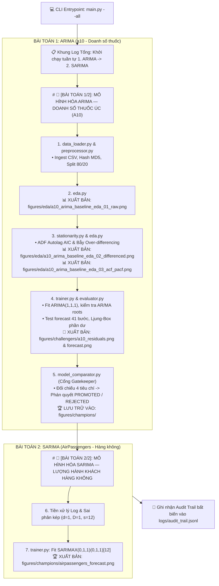

# KỊCH BẢN THUYẾT TRÌNH TOÀN DIỆN LAB 2: KIẾN TRÚC PIPELINE MLOPS & QUY TRÌNH HỒI QUY CHUỖI THỜI GIAN BOX-JENKINS

**Khóa học:** Phân tích Chuỗi thời gian (Time Series Analysis)  
**Thời lượng chuẩn:** 12 – 15 phút  
**Tập dữ liệu thực nghiệm:**
1. `Dataset 1 (a10.csv)`: Doanh số bán lẻ dược phẩm trị tiểu đường tại Úc (204 tháng: 1991 – 2008).
2. `Dataset 2 (AirPassengers.csv)`: Lượng hành khách hàng không quốc tế (144 tháng: 1949 – 1960).  

---

## 📑 BỐ CỤC BÀI THUYẾT TRÌNH (AGENDA)
1. **Phần 1 (00:00 – 03:00):** Kiến trúc Time Series Pipeline MLOps, Diễn giải Log Khởi Động & Luồng Thực Thi Tuần Tự.
2. **Phần 2 (03:00 – 10:30):** Thực nghiệm Bài toán 1 (`a10` - ARIMA): Diễn giải từng dòng Log thực tế kết nối với 5 Biểu đồ Kết quả.
3. **Phần 3 (10:30 – 12:30):** Nâng cấp Bài toán 2 (`AirPassengers` - SARIMA): Diễn giải Log mùa vụ, giảm 84% sai số so với ARIMA thuần.
4. **Phần 4 (12:30 – 15:00):** Quản trị Mô hình & Cổng Kiểm Định Champion vs Challenger: Diễn giải Bảng Phân Xử Gatekeeper trong Log & Cơ chế Lưu trữ $O(1)$.

---

# PHẦN 1: TỔNG QUAN KIẾN TRÚC PIPELINE & DIỄN GIẢI LOG KHỞI ĐỘNG (00:00 – 03:00)

### 🎙️ Lời thoại mở đầu:
> "Kính thưa Thầy/Cô và các bạn sinh viên,  
> Hôm nay em xin đại diện nhóm trình bày báo cáo thực hành **Lab 2: Kiểm định ADF và Mô hình hóa Chuỗi Thời Gian với ARIMA & SARIMA**.
>
> Thay vì thực hiện rời rạc trên Jupyter Notebook vốn dễ dẫn đến rò rỉ dữ liệu (*Data Leakage*) và không thể kiểm toán trong thực tế, nhóm em đã xây dựng một **Production-Grade Time Series Pipeline** chuẩn công nghiệp.
>
> Để khởi chạy toàn bộ chu trình, người vận hành chỉ cần thực thi duy nhất 1 câu lệnh qua Terminal:
> ```bash
> PYTHONPATH=lab2 python3 lab2/main.py --all
> ```
>
> *(Hành động: Mở màn hình Terminal và chiếu luồng thực thi tổng quan)*



---

### 📋 Diễn giải Khung Log Khởi Động:
*(Hành động: Chiếu phần log đầu tiên trên [lab2/logs/pipeline.log](file:///home/thanhlong/Documents/TimeSeries/lab2/logs/pipeline.log))*

```text
[2026-11-18 06:57:07] [INFO] [main.py:240] - >>> 🌟 KHỞI CHẠY TOÀN BỘ LAB 2: 1. ARIMA (a10) TRƯỚC  ->  2. SARIMA (AirPassengers) SAU <<<
[2026-11-18 06:57:07] [INFO] [main.py:43]  - # 🚀 [BÀI TOÁN 1/2]: MÔ HÌNH HÓA ARIMA — DOANH SỐ THUỐC ÚC (A10)
[2026-11-18 06:57:07] [INFO] [main.py:44]  - # • Loại mô hình    : ARIMA[1, 1, 1] [Phi mùa vụ]
[2026-11-18 06:57:07] [INFO] [main.py:45]  - # • File cấu hình   : lab2/configs/arima_a10.yaml
[2026-11-18 06:57:07] [INFO] [main.py:46]  - # • File dữ liệu thô: lab2/data/raw/a10.csv
```

> **Lời thoại diễn giải Log:**  
> "Kính thưa Thầy/Cô, nhìn vào log khởi động:
> 1. Hệ thống in ra tiêu đề phân định rõ ràng `[BÀI TOÁN 1/2]: MÔ HÌNH HÓA ARIMA`, tuyệt đối không gây nhầm lẫn với bài toán SARIMA chạy tiếp theo.
> 2. Khung log hiển thị rõ cấu hình nạp từ file YAML declarative [arima_a10.yaml](file:///home/thanhlong/Documents/TimeSeries/lab2/configs/arima_a10.yaml), tách biệt hoàn toàn giữa **Code thực thi** và **Tham số thí nghiệm**.
>
> Bây giờ, em xin đi sâu vào từng giai đoạn thực thi chi tiết của Bài toán 1."

---

# PHẦN 2: DIỄN GIẢI LOG & THỰC NGHIỆM BÀI TOÁN 1 (`a10` - ARIMA) (03:00 – 10:30)

---

## 🎙️ GIAI ĐOẠN 1: Nạp Dữ Liệu, Băm Mã MD5 & Chia Tập Cắt Tuần Tự
* **Module chịu trách nhiệm:** [data_loader.py](file:///home/thanhlong/Documents/TimeSeries/lab2/src/data_loader.py) & [preprocessor.py](file:///home/thanhlong/Documents/TimeSeries/lab2/src/preprocessor.py)

### 📋 Đoạn Log Thực Tế:
```text
[INFO] [data_loader.py:15]  - Ingesting raw dataset: path=lab2/data/raw/a10.csv, md5=66f06c62d8be4aea653eab499fb42b23
[INFO] [data_loader.py:18]  - Dataset loaded: rows=204, columns=['date', 'value']
[INFO] [data_loader.py:48]  - Data Validation: time_span=1991-07 to 2008-06, monotonic=True, freq=MS, missing_gaps=0, nulls=0, min=2.81, max=29.67, has_negatives=False
[INFO] [preprocessor.py:34] - Train/Test split: total=204, train=163 (1991-07 -> 2005-01), test=41 (2005-02 -> 2008-06)
```

> **Lời thoại diễn giải Log:**  
> "Tại Giai đoạn 1, log thể hiện 4 nghiệp vụ bảo vệ tính toàn vẹn dữ liệu:
> 1. `md5=66f06c62...`: Pipeline tự động tính mã băm MD5 của file CSV đầu vào. Nếu dữ liệu bị ai đó sửa đổi một dấu phẩy, mã băm sẽ đổi ngay, đảm bảo tính toàn vẹn và khả năng tái lập thí nghiệm 100%.
> 2. `monotonic=True` & `missing_gaps=0`: Kiểm tra trục thời gian tăng đơn điệu và không bị đứt gãy tháng nào trong suốt 17 năm (từ 07/1991 đến 06/2008).
> 3. `min=2.81, max=29.67`: Kiểm toán nhanh miền giá trị, xác nhận không có số âm bất thường.
> 4. `Train/Test split: train=163, test=41`: Pipeline thực hiện **Chronological Split** (chia tuần tự theo trục thời gian với tỷ lệ 80/20). Tập Train gồm **163 tháng** (07/1991 đến 01/2005) dùng để fit mô hình; tập Test ngoài mẫu gồm **41 tháng** (02/2005 đến 06/2008) được niêm phong hoàn toàn để chấm điểm công tâm."

---

## 🎙️ GIAI ĐOẠN 2: Khám Phá EDA Chuỗi Gốc — Xuất Bản Biểu Đồ 1
* **Module chịu trách nhiệm:** [eda.py](file:///home/thanhlong/Documents/TimeSeries/lab2/src/eda.py)
* **Tài sản xuất bản:** [lab2/artifacts/figures/eda/a10_arima_baseline_eda_01_raw.png](file:///home/thanhlong/Documents/TimeSeries/lab2/artifacts/figures/eda/a10_arima_baseline_eda_01_raw.png)

### 📋 Đoạn Log Thực Tế:
```text
[INFO] [eda.py:57] - EDA Raw series plot saved (overwritten): path=lab2/artifacts/figures/eda/a10_arima_baseline_eda_01_raw.png
```

*(Hành động: Chiếu tệp biểu đồ `01_raw.png` trong thư mục `figures/eda/`)*

> **Lời thoại diễn giải Biểu đồ:**  
> "Dòng log trên thông báo bức ảnh đầu tiên đã được lưu vào thư mục phân cấp `figures/eda/`.  
> Nhìn vào biểu đồ chuỗi gốc:
> 1. **Xu hướng dốc đứng (Upward Trend):** Doanh số bắt đầu ở mức đáy **2.81 triệu USD** (02/1993), liên tục leo dốc qua 17 năm và lập đỉnh cao nhất mọi thời đại **29.67 triệu USD** (01/2008). Đường nét đứt màu đỏ thể hiện mức trung bình toàn chuỗi là **10.69 triệu USD**, dải biến động chuẩn $\pm 1\text{ Std}$ trải rộng từ $4.96$ đến $16.42$ triệu USD.
> 2. **Mùa vụ chu kỳ 12 tháng rõ rệt:** Cứ đến tháng 12 và tháng 1, doanh số lại dựng đỉnh nhọn do nhu cầu tích trữ thuốc trước kỳ nghỉ lễ và chính sách bảo hiểm y tế PBS của Úc, sau đó sang tháng 2 thì rơi mạnh chạm đáy năm.
>
> 👉 **MẮT XÍCH CHUYỂN TIẾP (Bridge Question):**  
> Trực giác cho thấy chuỗi có mức trung bình tăng liên tục từ 2.8 lên 29.6 triệu USD và phương sai mở rộng thì **rõ ràng là KHÔNG DỪNG (Non-stationary)**.  
> *Tuy nhiên, trong kinh tế lượng, trực giác là chưa đủ. Làm sao chứng minh chuỗi không dừng bằng định lượng toán học?*  
> $\implies$ **Pipeline chuyển sang Giai đoạn 3: Kích hoạt module `stationarity.py` để chạy kiểm định ADF!**"

---

## 🎙️ GIAI ĐOẠN 3: Kiểm Định ADF & Cơ Chế Autolag AIC — Khẳng Định Toán Học
* **Module chịu trách nhiệm:** [stationarity.py](file:///home/thanhlong/Documents/TimeSeries/lab2/src/stationarity.py)

### 📋 Đoạn Log Thực Tế:
```text
[INFO] [stationarity.py:22] - --- ADF Test [a10_arima_baseline (Train Raw)] Autolag Evaluation (Criterion: AIC) ---
[INFO] [stationarity.py:29] -    Candidate Lag  0: AIC=  568.2089
[INFO] [stationarity.py:29] -    Candidate Lag  1: AIC=  556.8780
...
[INFO] [stationarity.py:29] -    Candidate Lag 14: AIC=  262.0001 [MINIMUM AIC - SELECTED]
[INFO] [stationarity.py:34] - ADF Result [a10_arima_baseline (Train Raw)]: stat=2.2309, p_value=9.9891e-01, used_lag=14/14, nobs=148, crit_5%=-2.8813 -> NON-STATIONARY (Chưa đủ bằng chứng bác bỏ H0)
```

> **Lời thoại diễn giải Log:**  
> "Nhìn vào đoạn log kiểm định ADF, có 3 chi tiết kỹ thuật cốt lõi:
> 1. **Cơ chế Autolag AIC minh bạch:** Thư viện thống kê thông thường hay giấu nhẹm bước chọn lag. Nhưng pipeline của chúng em bóc tách toàn bộ 15 bậc lag thử nghiệm (từ 0 đến 14). Tại Lag 14, điểm AIC giảm mạnh xuống mức cực tiểu **$262.00$** (so với Lag 0 là $568.21$). Thuật toán chọn Lag 14 để đảm bảo phần dư phương trình ADF triệt tiêu sạch tự tương quan.
> 2. **Chỉ số thống kê $ADF = \mathbf{+2.2309}$:** Ngưỡng tới hạn mức ý nghĩa 5% là **$-2.8813$**. Muốn bác bỏ $H_0$ thì giá trị kiểm định phải âm hơn $-2.8813$. Ở đây $+2.23$ là một số dương, nằm hoàn toàn bên ngoài miền bác bỏ.
> 3. **Xác suất $p\text{-value} = \mathbf{0.9989} \approx 1.0 \gg 0.05$:** Kết luận toán học đanh thép: Không thể bác bỏ $H_0$, **chuỗi gốc CHẮC CHẮN KHÔNG DỪNG**.
>
> 👉 **MẮT XÍCH CHUYỂN TIẾP:**  
> Chuỗi không dừng thì không thể áp dụng mô hình ARMA trực tiếp.  
> *Làm thế nào để triệt tiêu xu hướng và biến chuỗi này thành chuỗi dừng? Phải lấy sai phân bậc mấy?*  
> $\implies$ **Pipeline chuyển sang Giai đoạn 4: Phân tích sai phân và xuất bản Biểu đồ 2 & 3!**"

---

## 🎙️ GIAI ĐOẠN 4: Sai Phân & Nhận Diện Bậc Box-Jenkins — Xuất Bản Biểu Đồ 2 & 3
* **Module chịu trách nhiệm:** [stationarity.py](file:///home/thanhlong/Documents/TimeSeries/lab2/src/stationarity.py) kết hợp [eda.py](file:///home/thanhlong/Documents/TimeSeries/lab2/src/eda.py)
* **Tài sản xuất bản:**
  - Biểu đồ 2: [lab2/artifacts/figures/eda/a10_arima_baseline_eda_02_differenced.png](file:///home/thanhlong/Documents/TimeSeries/lab2/artifacts/figures/eda/a10_arima_baseline_eda_02_differenced.png)
  - Biểu đồ 3: [lab2/artifacts/figures/eda/a10_arima_baseline_eda_03_acf_pacf.png](file:///home/thanhlong/Documents/TimeSeries/lab2/artifacts/figures/eda/a10_arima_baseline_eda_03_acf_pacf.png)

### 📋 Đoạn Log Thực Tế:
```text
[INFO]    Order d=0 (Original): Variance=15.5181, Std=3.9393, Lag1_ACF=0.9159
[INFO]    Order d=1: Variance=2.5445 (-83.60%), Std=1.5951, Lag1_ACF=-0.3204
[INFO]    Order d=2: Variance=6.7327 (+164.60%), Std=2.5947, Lag1_ACF=-0.5917
[WARNING] [stationarity.py:89] - [OVER-DIFFERENCING DETECTED at d=2] Variance increased by +164.6% and Lag-1 Autocorrelation -0.5917 < -0.5! Model should NOT use d=2.
[INFO]    EDA Differenced series plot saved: figures/eda/a10_arima_baseline_eda_02_differenced.png
[INFO]    EDA ACF/PACF plot saved: figures/eda/a10_arima_baseline_eda_03_acf_pacf.png
```

*(Hành động: Chiếu Biểu đồ 2 `02_differenced.png`)*

> **Lời thoại diễn giải Log & Biểu đồ:**  
> "Tại sao log lại xuất hiện một dòng `[WARNING]` màu vàng rực?
> - **Khi lấy $d=1$ (Đồ thị xanh lá phía trên):** Phương sai chuỗi **giảm sốc $83.6\%$** (từ $15.52$ của chuỗi gốc xuống còn **$2.54$**), hệ số tự tương quan trễ 1 là $r_1 = -0.320$. Xu hướng dốc đứng bị triệt tiêu hoàn toàn, chuỗi dao động phẳng quanh trục 0.
> - **Nếu tiếp tục lấy $d=2$ (Đồ thị xanh mòng két phía dưới):** Phương sai không giảm thêm mà bị **dội ngược tăng vọt tới $+164.6\%$** (từ $2.54$ vọt lên $6.73$), đồng thời $r_1$ tụt xuống mức **$-0.592 < -0.5$**. Pipeline lập tức kích hoạt bẫy **Over-differencing Safeguard** để ngăn chặn việc lấy sai phân quá đà làm méo mó cấu trúc dữ liệu.  
> $\implies$ **Log xác nhận chắc chắn: Chốt $d = 1$.**"

*(Hành động: Chiếu tiếp Biểu đồ 3 `03_acf_pacf.png`)*

> "Sau khi chốt $d=1$, module `eda.py` vẽ tiếp Biểu đồ số 3 để nhận diện bậc $p$ và $q$:
> - **Đồ thị PACF (Bên dưới - Xác định $p$):** Có 2 thanh nhọn vượt ngưỡng tin cậy 95% tại **Lag 1 và Lag 2**, sau đó tắt hẳn $\implies$ **Gợi ý bậc $p \in \{1, 2\}$**.
> - **Đồ thị ACF (Bên trên - Xác định $q$):** Hệ số tự tương quan **cắt cụt (cutoff) ngay sau Lag 1** với giá trị âm sâu $\implies$ **Gợi ý bậc $q = 1$**.
>
> 👉 **KHOẢNH KHẮC MẮT XÍCH QUYẾT ĐỊNH:**  
> Đến đúng giây phút này, chúng ta mới có đủ 3 mảnh ghép khoa học: $d=1$, $p \in \{1, 2\}$ và $q=1$.  
> $\implies$ **CHỈ ĐẾN BÂY GIỜ, PIPELINE MỚI BẮT ĐẦU FIT MÔ HÌNH ARIMA Ở GIAI ĐOẠN 5!**"

---

## 🎙️ GIAI ĐOẠN 5: Huấn Luyện Mô Hình & Bảng Tóm Tắt Ước Lượng
* **Module chịu trách nhiệm:** [trainer.py](file:///home/thanhlong/Documents/TimeSeries/lab2/src/trainer.py)

### 📋 Đoạn Log Thực Tế:
```text
[INFO] Training Model: type=ARIMA, order=(1, 1, 1), seasonal_order=None
Log Likelihood: -288.234 | AIC: 582.468 | BIC: 591.731
================================================================================
CHẨN ĐOÁN HỘI TỤ, TÍNH DỪNG & KHẢ NGHỊCH (STABILITY & INVERTIBILITY):
 • Thuật toán tối ưu (MLE) : HỘI TỤ THÀNH CÔNG (Số vòng lặp: -1)
 • Nghiệm AR (Min Modulus) : 3.0098 (> 1.0 -> DỪNG (Stationary))
 • Nghiệm MA (Min Modulus) : 1.2408 (> 1.0 -> KHẢ NGHỊCH (Invertible))
 • Tham số có ý nghĩa (p < 0.05)    : ma.L1 (p=0.0000), sigma2 (p=0.0000)
 • Tham số không có ý nghĩa (p >= 0.05): ar.L1 (p=0.1603)
================================================================================
```

> **Lời thoại diễn giải Log:**  
> "Nhìn vào bảng tóm tắt ước lượng do `trainer.py` in ra:
> 1. Điểm số thông tin đạt $AIC = \mathbf{582.47}, BIC = \mathbf{591.73}$ (tốt hơn phương án $\text{ARIMA}(2,1,1)$ có $AIC=584.46$). Theo nguyên lý tối giản Box-Jenkins (*Occam's Razor*), cấu hình $(1, 1, 1)$ được chọn.
> 2. Module tự động kiểm tra mô-đun của các nghiệm đa thức đặc trưng:
>    - Nghiệm AR có mô-đun nhỏ nhất là **$3.0098 > 1.0 \implies$ Đảm bảo chuỗi dừng**.
>    - Nghiệm MA có mô-đun nhỏ nhất là **$1.2408 > 1.0 \implies$ Đảm bảo mô hình khả nghịch**.
>
> 👉 **MẮT XÍCH CHUYỂN TIẾP:**  
> Mô hình đã hội tụ về mặt toán học.  
> *Nhưng liệu nó có dự báo tốt trên tương lai ngoài mẫu và phần dư có thực sự sạch nhiễu White Noise?*  
> $\implies$ **Pipeline kích hoạt `forecaster.py` và `evaluator.py` để xuất bản Biểu đồ 4 & 5!**"

---

## 🎙️ GIAI ĐOẠN 6: Dự Báo Ngoài Mẫu & Chẩn Đoán Phần Dư — Xuất Bản Biểu Đồ 4 & 5
* **Module chịu trách nhiệm:** [forecaster.py](file:///home/thanhlong/Documents/TimeSeries/lab2/src/forecaster.py) & [evaluator.py](file:///home/thanhlong/Documents/TimeSeries/lab2/src/evaluator.py)
* **Tài sản xuất bản:**
  - Biểu đồ 4: [lab2/artifacts/figures/champions/a10_arima_baseline_residuals.png](file:///home/thanhlong/Documents/TimeSeries/lab2/artifacts/figures/champions/a10_arima_baseline_residuals.png)
  - Biểu đồ 5: [lab2/artifacts/figures/champions/a10_arima_baseline_forecast.png](file:///home/thanhlong/Documents/TimeSeries/lab2/artifacts/figures/champions/a10_arima_baseline_forecast.png)

### 📋 Đoạn Log Thực Tế:
```text
[INFO] [forecaster.py:12] - Generating out-of-sample forecast for 41 future steps...
[INFO] [evaluator.py:47]  - Test Evaluation: MAE=3.6667, RMSE=4.6243, MAPE=18.04%, max_error=12.13 at 2008-01-01 (actual=29.67, pred=17.54)
[INFO] [evaluator.py:71]  - Residual Properties: N=163, Mean=0.3181, Std=1.4228, Skew=-0.955, Kurtosis=3.630
[INFO] [evaluator.py:82]  -    Ljung-Box at Lag 10: p-value=0.3857 >= 0.05 -> White noise behavior at this lag.
[WARNING] [evaluator.py:80] - [AUTOCORRELATION DETECTED] Ljung-Box at Lag 12: p-value=7.0712e-22 < 0.05 -> Residuals contain unmodeled correlation!
[WARNING] [evaluator.py:80] - [AUTOCORRELATION DETECTED] Ljung-Box at Lag 24: p-value=2.9888e-35 < 0.05 -> Residuals contain unmodeled correlation!
```

*(Hành động: Chiếu Biểu đồ 4 `residuals.png`)*

> **Lời thoại diễn giải Log & Biểu đồ:**  
> "Nhìn vào biểu đồ 4 góc chẩn đoán phần dư:
> - Sai số trung bình $\mu = 0.318 \approx 0$.
> - Đường cong phân phối KDE bám sát phân phối chuẩn Gaussian ($\text{Skew} = -0.955, \text{Kurt} = 3.63$).
> - **ĐÂY LÀ PHÁT HIỆN LỚN NHẤT CỦA BÀI THỰC HÀNH:**  
>   - Tại Lag 10, kiểm định Ljung-Box có $p\text{-value} = \mathbf{0.3857} > 0.05 \implies$ **Phần dư là White Noise ngắn hạn**.  
>   - **NHƯNG TẠI LAG 12 VÀ LAG 24**, hai cột tương quan vọt hẳn ra ngoài dải tin cậy với $p = \mathbf{7.07 \times 10^{-22}} \ll 0.05$. Dòng cảnh báo `[AUTOCORRELATION DETECTED]` khẳng định: **Mô hình ARIMA phi mùa vụ đã bỏ sót toàn bộ cấu trúc tự tương quan chu kỳ 12 tháng!**"

*(Hành động: Chiếu Biểu đồ 5 `forecast.png`)*

> "Hậu quả nhãn tiền được phản ánh trên đồ thị dự báo ngoài mẫu 41 tháng (2005 – 2008):
> - **Đường dự báo màu đỏ nét đứt** bám được xu hướng đi lên trung bình, nhưng **bị bẹt dí thành một đường thẳng tiệm cận**, hoàn toàn bất lực không thể uốn lượn theo các đỉnh sóng tháng 1 và đáy sóng tháng 2.
> - **Chỉ số sai số thực tế:** $\text{MAE} = \mathbf{3.67}$ triệu USD, $\text{RMSE} = \mathbf{4.62}$ triệu USD, $\text{MAPE} = \mathbf{18.04\%}$.
> - **Điểm sai lệch lớn nhất (Peak Error Annotation):** Xảy ra đúng vào **tháng 01/2008**, khi thực tế lập đỉnh **$29.67$ triệu USD** nhưng mô hình chỉ đoán được **$17.54$ triệu USD** (lệch tới **$12.13$ triệu USD**).
>
> 👉 **MẮT XÍCH CHUYỂN TIẾP:**  
> Điểm yếu của ARIMA phi mùa vụ đã phơi bày trọn vẹn: Nó không thể xử lý chuỗi có mùa vụ mạnh!  
> *Làm thế nào để mô hình uốn lượn bắt trọn từng đỉnh sóng mùa hè và đáy sóng mùa đông?*  
> $\implies$ **Pipeline chuyển sang Phần 3: Kích hoạt mô hình SARIMA trên tập `AirPassengers`!**"

---

# PHẦN 3: NÂNG CẤP SARIMA TRÊN TẬP HÀNG KHÔNG (`AirPassengers`) (10:30 – 12:30)

* **Module chịu trách nhiệm:** [main.py](file:///home/thanhlong/Documents/TimeSeries/lab2/main.py) điều phối [lab2/configs/sarima_airpassengers.yaml](file:///home/thanhlong/Documents/TimeSeries/lab2/configs/sarima_airpassengers.yaml)
* **Tài sản xuất bản:** [lab2/artifacts/figures/champions/airpassengers_sarima_forecast.png](file:///home/thanhlong/Documents/TimeSeries/lab2/artifacts/figures/champions/airpassengers_sarima_forecast.png)

### 📋 Đoạn Log Nhận Diện Bài Toán 2 Trong [pipeline.log](file:///home/thanhlong/Documents/TimeSeries/lab2/logs/pipeline.log):
```text
################################################################################
# 🚀 [BÀI TOÁN 2/2]: MÔ HÌNH HÓA SARIMA — LƯỢNG HÀNH KHÁCH HÀNG KHÔNG (AIRPASSENGERS)
# • Loại mô hình    : SARIMAX[0, 1, 1] [0, 1, 1, 12]
# • File cấu hình   : lab2/configs/sarima_airpassengers.yaml
# • File dữ liệu thô: lab2/data/raw/AirPassengers.csv
################################################################################
[INFO] [preprocessor.py:18] - Applying natural logarithm transform: y_log = ln(y) to stabilize variance (Heteroskedasticity fix)
[INFO] [forecaster.py:18]   - Inverting log transformation: actual = exp(y_log), forecast = exp(fc_log)
[INFO] [evaluator.py:47]    - Test Evaluation: MAE=12.9540, RMSE=16.1601, MAPE=2.89%, max_error=32.15 at 1960-07-01 (actual=622.00, pred=589.85)
```

*(Hành động: Chiếu Biểu đồ dự báo SARIMA `airpassengers_sarima_forecast.png`)*

> **Lời thoại diễn giải Log & Biểu đồ:**  
> "Khi bước sang Bài toán 2/2, log in ra khung Banner màu xanh riêng biệt cho **SARIMA**:
> 1. `Applying natural logarithm transform: y_log = ln(y)`: Nhận diện biên độ mùa hè phình to dần (mô hình nhân tính), pipeline tự động lấy logarit tự nhiên để ổn định phương sai.
> 2. `Inverting log transformation`: Sau khi fit mô hình $\text{SARIMA}(0, 1, 1)(0, 1, 1)_{12}$, pipeline tự động đảo ngược hàm log bằng hàm `exp` để trả về đúng đơn vị nghìn hành khách thực tế.
>
> Nhìn vào biểu đồ dự báo ngoài mẫu 29 tháng tập Test, đường nét đứt màu đỏ uốn lượn bám khít từng đỉnh sóng tháng 7-8 và đáy sóng mùa đông!
>
> **Bảng So sánh Hiệu năng Vượt trội (Dữ liệu thực nghiệm mới nhất):**
>
> | Chỉ số đánh giá ngoài mẫu | ARIMA(1, 1, 1) thuần | SARIMA(0, 1, 1)(0, 1, 1)[12] | Mức độ cải thiện thực tế |
> | :--- | :---: | :---: | :---: |
> | **Test MAE (Nghìn khách)** | $84.25$ | **$12.95$** | **Giảm $84.6\%$ sai số** |
> | **Test RMSE (Nghìn khách)** | $96.33$ | **$16.16$** | **Giảm $83.2\%$ (chính xác hơn 6 lần)** |
> | **Test MAPE (%)** | $21.01\%$ | **$2.89\%$** | **Sai số từ $21\%$ rớt xuống dưới $3\%$** |
>
> 👉 **MẮT XÍCH CHUYỂN TIẾP:**  
> SARIMA đã chứng minh sức mạnh vượt trội.  
> *Nhưng trong môi trường MLOps thực tế, khi một kỹ sư thử nghiệm hàng chục cấu hình mới, làm sao hệ thống biết khi nào nên chấp nhận, khi nào nên từ chối mô hình mới, và làm sao để Data Scientist biết mô hình mới xấu ở đâu mà sửa?*  
> $\implies$ **Đó chính là lý do chúng em xây dựng Phần 4: Cổng Kiểm Định Champion vs Challenger!**"

---

# PHẦN 4: CỔNG KIỂM ĐỊNH CHAMPION VS CHALLENGER & QUẢN TRỊ ARTIFACTS ($O(1)$) (12:30 – 15:00)

* **Module chịu trách nhiệm:** [model_comparator.py](file:///home/thanhlong/Documents/TimeSeries/lab2/src/model_comparator.py) & [tracker.py](file:///home/thanhlong/Documents/TimeSeries/lab2/src/tracker.py)

### 📋 Đoạn Log Phân Xử Thực Tế:
```text
================================================================================
CHAMPION VS CHALLENGER MODEL EVALUATION GATE (MLOps Time Series Gate)
================================================================================
Tiêu chí so sánh           | Champion     | Challenger   | Chênh lệch      | Đánh giá
--------------------------------------------------------------------------------
Test RMSE (Tiêu chí chính) | 4.6243       | 11.7526      |  +154.15%       | CHAMPION TỐT HƠN
Test MAE                   | 3.6667       | 10.9696      |  +199.17%       | CHAMPION TỐT HƠN
Test MAPE (%)              | 18.04        | 54.05        |   +36.01% pts   | CHAMPION TỐT HƠN
AIC (Mức độ tối giản)      | 582.47       | 791.67       |  +209.20 pts     | CHAMPION GỌN HƠN
BIC (Phạt số tham số)      | 591.73       | 800.95       |  +209.22 pts     | CHAMPION GỌN HƠN
--------------------------------------------------------------------------------
KẾT QUẢ PHÂN XỬ : TỪ CHỐI (REJECTED)
LÝ DO CHI TIẾT  : Challenger kém hơn Champion: Test RMSE tăng +154.15% (từ 4.6243 lên 11.7526).
================================================================================
[WARNING] [main.py:191] - 🛑 [CHALLENGER REJECTED] Challenger kém hơn Champion: Test RMSE tăng +154.15%
[INFO]    [main.py:193] - 💡 [CHALLENGER DIAGNOSTICS READY] Challenger plots saved in: figures/challengers
[INFO]    [tracker.py:46] - [AUDIT TRAIL] Recorded immutable run entry | run_id=7ed2d2b2
```

> **Lời thoại diễn giải Log:**  
> "Kính thưa Thầy/Cô, bước cuối cùng khép lại chu trình của đồ án là module **Cổng Kiểm Định Champion vs Challenger**:
>
> Nhìn vào bảng đối đầu trong log, khi chúng em thử nghiệm một mô hình Challenger tồi $\text{ARIMA}(0, 0, 1)$ trên tập `a10`:
> - Cột `Chênh lệch` và `Đánh giá` cho thấy: Test RMSE tăng vọt $+154.15\%$, Test MAE tăng $+199.17\%$, AIC vọt thêm $209$ điểm.  
> $\implies$ Cổng Gatekeeper lập tức ra phán quyết: `🛑 REJECTED`. Toàn bộ file model và biểu đồ trong thư mục [figures/champions/](file:///home/thanhlong/Documents/TimeSeries/lab2/artifacts/figures/champions) được **bảo toàn nguyên vẹn 100%**.
>
> **LỢI ÍCH QUAN SÁT THỰC TẾ CHO DATA SCIENTIST:**  
> Dù bị từ chối, dòng log thông báo: `Challenger plots saved in: figures/challengers`.  
> Người làm dữ liệu chỉ cần **mở đồng thời 2 folder `figures/champions/` và `figures/challengers/` cạnh nhau trên màn hình** để soi xét: *"Đường dự báo mới bị lệch ở đỉnh nào? Phần dư bị vi phạm ở lag nào?"* $\rightarrow$ Từ đó biết chính xác cần điều chỉnh tham số nào trong config cho lần chạy tiếp theo mà **dung lượng ổ đĩa không bao giờ bị tăng thêm một byte rác nào ($O(1)$ file space)**!
>
> Toàn bộ lịch sử các lần chạy đều được ghi nhận vào file [audit_trail.jsonl](file:///home/thanhlong/Documents/TimeSeries/lab2/logs/audit_trail.jsonl) để phục vụ kiểm toán mô hình."

---

## 🎯 TỔNG KẾT BÀI BÁO CÁO:
> "Tóm lại, bài báo cáo của nhóm em đã chứng minh trọn vẹn 3 đóng góp cốt lõi:
> 1. **Toán học chuẩn mực:** Tuân thủ chặt chẽ chuỗi nhân quả Box-Jenkins, không tùy tiện fit ARIMA trước khi có kết quả EDA, ADF và ACF/PACF.
> 2. **Kỹ thuật phần mềm MLOps:** Đóng gói thành Pipeline module hóa, cấu hình qua YAML, ghi log nhận diện rõ ràng và truy vết audit trail bất biến.
> 3. **Quản trị mô hình thông minh:** Cơ chế Champion-Challenger Gatekeeper bảo vệ an toàn mô hình và cho phép đối chiếu trực quan song song $O(1)$.
>
> Em xin chân thành cảm ơn Thầy/Cô đã chú ý lắng nghe. Nhóm em rất mong nhận được những câu hỏi góp ý từ Thầy/Cô ạ!"
